# 📚 BÁO CÁO BÀI TẬP LỚN / ĐỒ ÁN MÔN HỌC
## ĐỀ TÀI: XÂY DỰNG HỆ THỐNG QUẢN TRỊ & BÁN HÀNG TRỰC TUYẾN UTC (PROJECT UTC)

> **Cơ sở đào tạo:** Trường Đại học Giao thông Vận tải (UTC)  
> **Khoa / Ngành:** Công nghệ Thông tin - Kỹ thuật Phần mềm  
> **Ngôn ngữ & Nền tảng:** Java 21 LTS, Spring Boot 3.4.x, Next.js 16, MySQL 8 / H2 Database, Docker  
> **Sinh viên thực hiện:** Đoàn Mạnh  
> **Mã số sinh viên (MSSV):** 233030594  

---

## 🔤 DANH MỤC CÁC TỪ VIẾT TẮT

| STT | Từ viết tắt | Thuật ngữ tiếng Anh đầy đủ | Giải nghĩa tiếng Việt |
| :---: | :--- | :--- | :--- |
| 1 | **API** | Application Programming Interface | Giao diện lập trình ứng dụng |
| 2 | **REST** | Representational State Transfer | Kiểu kiến trúc truyền tải trạng thái đại diện cho các Web Service |
| 3 | **JWT** | JSON Web Token | Chuẩn mở (RFC 7519) định nghĩa phương thức xác thực an toàn bằng token |
| 4 | **JPA** | Jakarta / Java Persistence API | Bộ đặc tả tiêu chuẩn ánh xạ đối tượng - quan hệ trong hệ sinh thái Java |
| 5 | **ORM** | Object-Relational Mapping | Kỹ thuật ánh xạ dữ liệu giữa cơ sở dữ liệu quan hệ và mã nguồn hướng đối tượng |
| 6 | **DTO** | Data Transfer Object | Đối tượng vận chuyển dữ liệu giữa các tầng kiến trúc hệ thống |
| 7 | **CRUD** | Create - Read - Update - Delete | Bốn thao tác dữ liệu cơ bản: Thêm, Đọc, Sửa, Xóa |
| 8 | **ACID** | Atomicity - Consistency - Isolation - Durability | Bốn thuộc tính bảo đảm tính toàn vẹn của một giao dịch cơ sở dữ liệu |
| 9 | **BCrypt** | Blowfish Cipher Algorithm | Giải thuật băm mật khẩu một chiều có muối bảo mật cao |
| 10 | **OTP** | One-Time Password | Mật khẩu xác thực một lần có thời hạn gửi qua email/SMS |
| 11 | **SMTP** | Simple Mail Transfer Protocol | Giao thức mạng chuẩn phục vụ gửi thư điện tử |
| 12 | **HMAC** | Hash-based Message Authentication Code | Mã xác thực thông điệp sử dụng hàm băm mật mã và khóa bí mật |
| 13 | **VNPAY** | Vietnam Payment Solution | Cổng giải pháp thanh toán điện tử trực tuyến quốc gia |
| 14 | **SKU** | Stock Keeping Unit | Mã quản lý đơn vị lưu kho và phân loại hàng hóa |
| 15 | **POS** | Point of Sale | Điểm bán lẻ / Phần mềm quản lý đơn hàng tại quầy |
| 16 | **ERD** | Entity Relationship Diagram | Sơ đồ quan hệ thực thể mô hình hóa dữ liệu |
| 17 | **DBML** | Database Markup Language | Ngôn ngữ định nghĩa cấu trúc cơ sở dữ liệu trực quan |
| 18 | **UI/UX** | User Interface / User Experience | Giao diện người dùng / Trải nghiệm người dùng |
| 19 | **SEO** | Search Engine Optimization | Tối ưu hóa khả năng nhận diện trên các công cụ tìm kiếm |
| 20 | **CI/CD** | Continuous Integration / Deployment | Quy trình tích hợp và triển khai mã nguồn tự động |

---

## 📊 DANH MỤC BẢNG BIỂU VÀ SƠ ĐỒ

### 1. Danh mục Bảng biểu (List of Tables)
* **Bảng 1.1:** Bảng phân công nhiệm vụ & mức độ hoàn thành
* **Bảng 1.2:** Bảng tổng hợp công nghệ & môi trường phát triển
* **Bảng 2.1:** Đặc tả các Use Case chính của hệ thống
* **Bảng 2.2:** Cấu trúc chi tiết bảng `users`
* **Bảng 2.3:** Cấu trúc chi tiết bảng `categories`
* **Bảng 2.4:** Cấu trúc chi tiết bảng `products`
* **Bảng 2.5:** Cấu trúc chi tiết bảng `vouchers`
* **Bảng 2.6:** Cấu trúc chi tiết bảng `orders`
* **Bảng 2.7:** Cấu trúc chi tiết bảng `order_items`
* **Bảng 2.8:** Cấu trúc chi tiết bảng `order_vouchers`
* **Bảng 2.9:** Cấu trúc chi tiết bảng `suppliers`
* **Bảng 2.10:** Cấu trúc chi tiết bảng `goods_receipts`
* **Bảng 3.1:** Danh sách API Endpoints Module 1 (Người dùng & Xác thực JWT)
* **Bảng 3.2:** Danh sách API Endpoints Module 2 (Danh mục & Sản phẩm)
* **Bảng 3.3:** Danh sách API Endpoints Module 3 (Nhà cung cấp & Nhập kho)
* **Bảng 3.4:** Danh sách API Endpoints Module 4 (Mã giảm giá Voucher)
* **Bảng 3.5:** Danh sách API Endpoints Module 5 (Đơn hàng & Bán hàng)
* **Bảng 3.6:** Danh sách API Endpoints Module 6 (Cổng thanh toán VNPAY)
* **Bảng 3.7:** Danh sách API Endpoints Module 7 (Tải lên Media Cloudinary)
* **Bảng 3.8:** Danh sách API Endpoints Module 8 (Tìm kiếm, Sắp xếp & Thống kê)
* **Bảng 3.9:** Bảng chuẩn hóa 11 nhóm ngoại lệ toàn cục `GlobalExceptionHandler`
* **Bảng 3.10:** Danh sách API Endpoint Module 10 (Health Check)
* **Bảng 4.1:** Bảng kịch bản kiểm thử các ca tiêu biểu (Test Cases)
* **Bảng 4.2:** Danh sách tài khoản dùng thử nghiệm mặc định

### 2. Danh mục Sơ đồ & Hình vẽ (List of Figures & Diagrams)
* **Sơ đồ 2.1:** Sơ đồ Use Case tổng quan phân quyền hệ thống
* **Sơ đồ 2.2:** Sơ đồ kiến trúc phân lớp tổng thể (Layered Architecture)
* **Sơ đồ 2.3:** Sơ đồ lớp thực thể (Class Diagram)
* **Sơ đồ 2.4:** Lưu đồ Đăng nhập & Xác thực JWT Token
* **Sơ đồ 2.5:** Lưu đồ Đăng ký tài khoản người dùng mới
* **Sơ đồ 2.6:** Lưu đồ Quên mật khẩu & Đặt lại mật khẩu qua Email OTP
* **Sơ đồ 2.7:** Lưu đồ Thêm mới/Cập nhật Sản phẩm & Upload ảnh Cloudinary
* **Sơ đồ 2.8:** Lưu đồ Tìm kiếm, Lọc danh mục & Cảnh báo hàng tồn kho
* **Sơ đồ 2.9:** Lưu đồ Kiểm tra điều kiện & Áp dụng Voucher giảm giá
* **Sơ đồ 2.10:** Lưu đồ Tạo Đơn hàng & Trừ tồn kho theo Transaction
* **Sơ đồ 2.11:** Lưu đồ Thanh toán Trực tuyến qua Cổng VNPAY Sandbox
* **Sơ đồ 2.12:** Lưu đồ Quản lý Vòng đời Trạng thái Đơn hàng
* **Sơ đồ 2.13:** Lưu đồ Lập phiếu Nhập kho hàng hóa từ Nhà cung cấp

---

## 📑 MỤC LỤC CHI TIẾT

- [DANH MỤC CÁC TỪ VIẾT TẮT](#danh-mục-các-từ-viết-tắt)
- [DANH MỤC BẢNG BIỂU VÀ SƠ ĐỒ](#danh-mục-bảng-biểu-và-sơ-đồ)
- [Chương 1. TỔNG QUAN VỀ ĐỀ TÀI](#chương-1-tổng-quan-về-đề-tài)
  - [1.1. Giới thiệu đề tài & Mục tiêu nghiên cứu](#11-giới-thiệu-đề-tài--mục-tiêu-nghiên-cứu)
  - [1.2. Phân công công việc](#12-phân-công-công-việc)
  - [1.3. Khảo sát nghiệp vụ & Yêu cầu hệ thống](#13-khảo-sát-nghiệp-vụ--yêu-cầu-hệ-thống)
  - [1.4. Công nghệ sử dụng & Môi trường phát triển](#14-công-nghệ-sử-dụng--môi-trường-phát-triển)
- [Chương 2. PHÂN TÍCH THIẾT KẾ HỆ THỐNG](#chương-2-phân-tích-thiết-kế-hệ-thống)
  - [2.1. Phân tích tác nhân & Sơ đồ Use Case tổng quan](#21-phân-tích-tác-nhân--sơ-đồ-use-case-tổng-quan)
  - [2.2. Thiết kế kiến trúc chương trình (Layered Architecture)](#22-thiết-kế-kiến-trúc-chương-trình-layered-architecture)
  - [2.3. Sơ đồ lớp thực thể & Mối quan hệ giữa các lớp](#23-sơ-đồ-lớp-thực-thể--mối-quan-hệ-giữa-các-lớp)
  - [2.4. Lưu đồ xử lý các chức năng chính (10 Lưu đồ)](#24-lưu-đồ-xử-lý-các-chức-năng-chính)
  - [2.5. Thiết kế Cơ sở dữ liệu & Mã nguồn DBML dbdiagram.io](#25-thiết-kế-cơ-sở-dữ-liệu-và-mã-nguồn-dbdiagram)
  - [2.6. Thiết kế Giao diện dự kiến (UI Mockups)](#26-thiết-kế-giao-diện-dự-kiến)
- [Chương 3. HIỆN THỰC HÓA & CÀI ĐẶT CÁC MODULE](#chương-3-hiện-thực-hóa--cài-đặt-các-module)
  - [3.1. Module 1: Quản lý người dùng, tài khoản và xác thực JWT](#31-module-1-quản-lý-người-dùng-tài-khoản-và-xác-thực-user--authentication)
  - [3.2. Module 2: Quản lý danh mục và sản phẩm](#32-module-2-quản-lý-danh-mục-và-sản-phẩm-category--product-management)
  - [3.3. Module 3: Quản lý nhà cung cấp và nhập kho hàng hóa](#33-module-3-quản-lý-nhà-cung-cấp-và-nhập-kho-hàng-hóa-supplier--goods-receipt)
  - [3.4. Module 4: Quản lý mã giảm giá voucher](#34-module-4-quản-lý-mã-giảm-giá-voucher-voucher-management)
  - [3.5. Module 5: Quản lý đơn hàng và bán hàng](#35-module-5-quản-lý-đơn-hàng-và-bán-hàng-order-management)
  - [3.6. Module 6: Cổng thanh toán trực tuyến VNPAY Sandbox](#36-module-6-cổng-thanh-toán-trực-tuyến-vnpay-sandbox-online-payment)
  - [3.7. Module 7: Tải lên và lưu trữ Media Cloudinary](#37-module-7-tải-lên-và-lưu-trữ-media-cloudinary-upload-media)
  - [3.8. Module 8: Tìm kiếm, sắp xếp và thống kê](#38-module-8-tìm-kiếm-sắp-xếp-và-thống-kê-search-sort--statistics)
  - [3.9. Module 9: Kiểm tra dữ liệu và xử lý ngoại lệ toàn cục](#39-module-9-kiểm-tra-dữ-liệu-và-xử-lý-ngoại-lệ-toàn-cục-validation--exception-handling)
  - [3.10. Module 10: Giám sát trạng thái hệ thống (Health Check)](#310-module-10-giám-sát-trạng-thái-hệ-thống-health-check--system-monitoring)
- [Chương 4. KIỂM THỬ HỆ THỐNG & HƯỚNG DẪN CÀI ĐẶT](#chương-4-kiểm-thử-hệ-thống--hướng-dẫn-cài-đặt)
  - [4.1. Hướng dẫn môi trường & Khởi chạy hệ thống](#41-hướng-dẫn-môi-trường--khởi-chạy-hệ-thống)
  - [4.2. Kiểm thử API qua Swagger UI & Postman Collection](#42-kiểm-thử-api-qua-swagger-ui--postman-collection)
  - [4.3. Bảng kịch bản kiểm thử các ca tiêu biểu (Test Cases)](#43-bảng-kịch-bản-kiểm-thử-các-ca-tiêu-biểu-test-cases)
  - [4.4. Tài khoản dùng thử nghiệm mặc định](#44-tài-khoản-dùng-thử-nghiệm-mặc-định)
- [KẾT LUẬN & HƯỚNG PHÁT TRIỂN](#kết-luận)
  - [1. Kết quả đạt được](#1-kết-quả-đạt-được)
  - [2. Hạn chế & Hướng phát triển](#2-hướng-phát-triển)
- [DANH MỤC TÀI LIỆU THAM KHẢO](#danh-mục-tài-liệu-tham-khảo)

---

# Chương 1. TỔNG QUAN VỀ ĐỀ TÀI

## 1.1. Giới thiệu đề tài & Mục tiêu nghiên cứu

### 1. Bối cảnh & Lý do chọn đề tài
Trong thời đại chuyển đổi số và thương mại điện tử phát triển mạnh mẽ, việc tự động hóa chuỗi cung ứng, từ nhập kho, quản lý mặt hàng đến bán lẻ đa kênh và thanh toán trực tuyến là nhu cầu sống còn của các đơn vị kinh doanh. Đối với sinh viên ngành Công nghệ Thông tin tại **Trường Đại học Giao thông Vận tải (UTC)**, việc thực hiện đề tài **"Xây dựng Hệ thống Quản trị & Bán hàng Trực tuyến UTC"** là cơ hội lớn để áp dụng toàn diện các kiến thức:
* Lập trình hướng đối tượng nâng cao trên nền tảng **Java 21 LTS**.
* Kiến trúc phân lớp chuẩn doanh nghiệp (**Layered Architecture: Controller - Service - Repository - Entity/DTO**) trên nền **Spring Boot 3.4.x**.
* Cơ chế an toàn và bảo mật dữ liệu với **Spring Security** và **JSON Web Token (JWT)**.
* Thiết kế cơ sở dữ liệu quan hệ chuẩn 3NF, xử lý giao dịch ACID với **Spring Data JPA & Hibernate 6**.
* Tích hợp các dịch vụ bên thứ ba: Cổng thanh toán quốc gia **VNPAY Sandbox**, dịch vụ lưu trữ media đám mây **Cloudinary**, và dịch vụ gửi mail thông báo tự động **Gmail SMTP**.
* Xây dựng giao diện hiện đại với **Next.js 16 (React 19, TypeScript, Tailwind CSS)**.

### 2. Mục tiêu nghiên cứu
1. Nghiên cứu và hiện thực hóa kiến trúc RESTful API chuẩn, xử lý dữ liệu nhất quán qua `ApiResponse<T>`.
2. Đảm bảo tính toàn vẹn dữ liệu (`@Transactional`) trong các bài toán trừ kho khi bán hàng, cộng dồn kho khi nhập hàng từ nhà cung cấp.
3. Tối ưu hiệu năng truy vấn CSDL, loại bỏ triệt để lỗi *N+1 Query* bằng JPA `@EntityGraph`.
4. Xây dựng cơ chế bắt lỗi toàn cục bằng `@RestControllerAdvice` và kiểm soát dữ liệu chặt chẽ bằng *Jakarta Bean Validation*.

---

## 1.2. Phân công công việc

**Bảng 1.1: Bảng phân công nhiệm vụ & mức độ hoàn thành**

| STT | Thành viên thực hiện | MSSV | Vai trò | Nhiệm vụ đảm nhiệm chính | Mức độ hoàn thành |
| :---: | :--- | :---: | :---: | :--- | :---: |
| 1 | **Đoàn Mạnh** | **233030594** | Trưởng nhóm / Full-stack Developer | - Khảo sát bài toán, thiết kế CSDL (9 bảng chuẩn 3NF) và kiến trúc hệ thống.<br>- Xây dựng toàn bộ Backend Spring Boot 3 (Security JWT, 12 Controllers, Services, Repositories).<br>- Tích hợp dịch vụ bên thứ 3 (VNPAY, Cloudinary, Gmail SMTP).<br>- Xây dựng Frontend Next.js (App Router, Tailwind CSS, Auth Flow, Admin Orders & Goods Receipt).<br>- Viết tài liệu kiểm thử (Swagger UI, Postman Collection, Báo cáo đề tài). | **100%** |

---

## 1.3. Khảo sát nghiệp vụ & Yêu cầu hệ thống

### 1. Yêu cầu chức năng (Functional Requirements)
Hệ thống phục vụ 4 nhóm tác nhân chính:
* **Khách vãng lai (Guest):**
  * Duyệt danh mục sản phẩm, tìm kiếm theo từ khóa, lọc theo khoảng giá và tiêu chuẩn chất lượng.
  * Quản lý giỏ hàng (`localStorage`), áp dụng mã giảm giá voucher.
  * Đặt hàng nhanh không cần đăng nhập (nhập họ tên, số điện thoại, địa chỉ giao hàng) và lựa chọn phương thức thanh toán: COD (Tiền mặt) hoặc VNPAY Sandbox (quét mã QR ngân hàng).
  * Tra cứu thông tin đơn hàng theo mã đơn (`orderCode`).
  * Đăng ký tài khoản mới, đăng nhập hoặc khôi phục mật khẩu qua mã OTP gửi về Gmail.
* **Khách hàng thành viên (Customer / Sinh viên):**
  * Kế thừa toàn bộ chức năng mua sắm và đặt hàng của Khách vãng lai, đồng thời tự động điền thông tin người nhận từ hồ sơ cá nhân.
  * Quản lý thông tin hồ sơ cá nhân, đổi mật khẩu và làm mới phiên đăng nhập (Refresh Token).
  * Theo dõi toàn bộ lịch sử đơn hàng đã đặt theo tài khoản (`userId`) và tích lũy điểm thưởng thành viên (`accumulatedPoints`).
* **Nhân viên / Thủ kho / Thu ngân (Staff / Cashier):**
  * Tạo đơn bán hàng trực tiếp tại quầy (`POS`) và in hóa đơn (`markAsPrinted`).
  * Quản lý thông tin chi tiết sản phẩm và danh mục.
  * Lập phiếu nhập kho (`GoodsReceipt`) từ các nhà cung cấp, hệ thống tự động cộng dồn số lượng tồn kho.
  * Kiểm tra danh sách mặt hàng sắp hết kho (`low-stock`) để kịp thời bổ sung hàng.
  * Tiếp nhận đơn hàng, duyệt đơn, bàn giao vận chuyển và cập nhật trạng thái đơn hàng.
* **Quản trị viên (Admin):**
  * Toàn quyền quản lý tài khoản người dùng, phân quyền (`ADMIN`, `STAFF`, `CUSTOMER`), khóa hoặc mở khóa tài khoản.
  * Quản lý thông tin nhà cung cấp hàng hóa (`Supplier`).
  * Khởi tạo các chương trình khuyến mãi, thiết lập mã voucher giảm giá.
  * Theo dõi báo cáo thống kê doanh thu và giám sát tình trạng hệ thống (`Health Check`).

### 2. Yêu cầu phi chức năng (Non-Functional Requirements)
* **Bảo mật:** Mật khẩu người dùng được băm một chiều bằng BCrypt; phiên làm việc được xác thực bằng JWT Bearer Token với thời hạn xác định; các endpoint API được phân quyền nghiêm ngặt theo Role.
* **Hiệu năng:** Thời gian phản hồi API trung bình dưới 100ms; sử dụng JPA EntityGraph giải quyết bài toán N+1 Query.
* **Toàn vẹn dữ liệu:** Mọi thao tác biến động kho và đặt hàng bắt buộc phải bảo đảm tính toàn vẹn ACID.
* **Giao diện người dùng:** Responsive trên nhiều thiết bị (Desktop, Tablet, Mobile) với Next.js và Tailwind CSS.

---

## 1.4. Công nghệ sử dụng & Môi trường phát triển

**Bảng 1.2: Bảng tổng hợp công nghệ & môi trường phát triển**

| Phân hệ / Thành phần | Công nghệ / Thư viện | Phiên bản | Vai trò & Mục đích sử dụng |
| :--- | :--- | :---: | :--- |
| **Ngôn ngữ Backend** | Java SDK | 21 LTS | Ngôn ngữ hướng đối tượng chính, sử dụng Record DTO, Pattern Matching |
| **Framework Backend**| Spring Boot | 3.4.3 | Khung phát triển ứng dụng RESTful API doanh nghiệp |
| **Bảo mật & Xác thực** | Spring Security & JJWT | 6.x / 0.12.6 | Bảo mật endpoint, mã hóa BCrypt, cấp phát và xác minh JWT Token |
| **Tầng dữ liệu (ORM)**| Spring Data JPA / Hibernate | 6.x | Tương tác cơ sở dữ liệu quan hệ, tự động sinh truy vấn và quản lý Transaction |
| **Cơ sở dữ liệu Test**| H2 Database | In-Memory | Cơ sở dữ liệu nhúng chạy ngầm phục vụ phát triển và kiểm thử nhanh |
| **Cơ sở dữ liệu Thật**| MySQL Server | 8.0.x | Hệ quản trị cơ sở dữ liệu quan hệ chính thức cho môi trường Production |
| **Lưu trữ Media Đám mây**| Cloudinary Java SDK | 1.39.0 | Tải lên và quản lý ảnh sản phẩm trên mạng phân phối nội dung (CDN) |
| **Cổng Thanh toán** | VNPAY SDK / Sandbox | 2024 | Tích hợp giải pháp thanh toán thẻ ngân hàng & quét mã QR |
| **Tài liệu API** | SpringDoc OpenAPI / Swagger UI| 2.8.5 | Tự động sinh giao diện tài liệu và công cụ kiểm thử API trực quan |
| **Tiện ích mã nguồn** | Project Lombok | 1.18.36 | Tự động sinh Getter, Setter, Builder giúp mã nguồn tinh gọn |
| **Frontend Framework**| Next.js (App Router) | 16.x (React 19) | Xây dựng giao diện người dùng Server-Side Rendering và Client-Side Rendering |
| **Styling** | Tailwind CSS | 4.x | Thiết kế giao diện hiện đại, tối ưu responsive |
| **Công cụ phát triển** | IntelliJ IDEA, VS Code, Postman, Docker | Latest | Môi trường lập trình, kiểm thử API và container hóa dịch vụ |

---

# Chương 2. PHÂN TÍCH THIẾT KẾ HỆ THỐNG

## 2.1. Phân tích tác nhân & Sơ đồ Use Case tổng quan

Hệ thống xác định **4 nhóm tác nhân** tương tác chính: **Khách vãng lai (Guest)**, **Khách hàng thành viên (Customer)**, **Nhân viên / Thủ kho / Thu ngân (Staff)** và **Quản trị viên (Admin)**. Trong đó, **Khách hàng thành viên** kế thừa toàn bộ quyền mua sắm/đặt hàng của **Khách vãng lai** và mở rộng thêm các tiện ích gắn với tài khoản định danh.

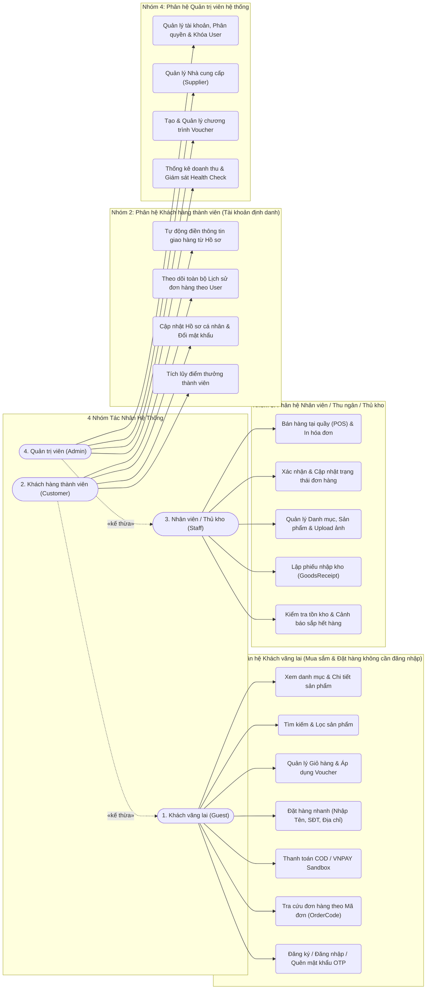

**Bảng 2.1: Đặc tả các Use Case chính theo 4 nhóm tác nhân của hệ thống**

| Nhóm tác nhân | Use Case chính | Mô tả hành động và kết quả |
| :--- | :--- | :--- |
| **1. Khách vãng lai (Guest)** | Tìm kiếm & Xem sản phẩm | Duyệt danh mục, tìm kiếm theo từ khóa, lọc theo giá/tiêu chuẩn, xem chi tiết sản phẩm. |
| **1. Khách vãng lai (Guest)** | Đặt hàng & Thanh toán | Thêm giỏ hàng, áp mã voucher, điền Họ tên/SĐT/Địa chỉ nhận hàng (`userId = null`), thanh toán COD hoặc VNPAY. |
| **1. Khách vãng lai (Guest)** | Tra cứu mã đơn & Xác thực | Tra cứu đơn theo `orderCode`; Đăng ký tài khoản mới, Đăng nhập hoặc Quên mật khẩu qua Email OTP. |
| **2. Khách hàng (Customer)** | Đặt hàng thành viên & Tích điểm | Kế thừa đặt hàng của Guest nhưng tự động điền thông tin từ hồ sơ (`userId` gắn với tài khoản) và cộng điểm tích lũy. |
| **2. Khách hàng (Customer)** | Quản lý hồ sơ & Lịch sử đơn | Cập nhật thông tin cá nhân, đổi mật khẩu; xem danh sách toàn bộ đơn hàng đã mua theo tài khoản. |
| **3. Nhân viên (Staff)** | Bán hàng POS & Xử lý đơn | Tạo đơn trực tiếp tại quầy (`channel = POS`), in hóa đơn; chuyển trạng thái `PENDING` ➔ `CONFIRMED` ➔ `SHIPPING` ➔ `COMPLETED`. |
| **3. Nhân viên (Staff)** | Quản lý sản phẩm & Nhập kho | Thêm/sửa sản phẩm, tải ảnh Cloudinary; lập phiếu nhập kho (`GoodsReceipt`) tự động cộng tồn kho và kiểm tra hàng sắp hết. |
| **4. Quản trị viên (Admin)** | Quản trị người dùng & Đối tác | Quản lý danh sách người dùng, cấp quyền nhân viên, khóa/mở khóa tài khoản; quản lý nhà cung cấp (`Supplier`). |
| **4. Quản trị viên (Admin)** | Quản lý Voucher & Thống kê | Thiết lập mã giảm giá (`Voucher`); xem báo cáo doanh thu, tổng hợp đơn hàng và giám sát `Health Check`. |

---

## 2.2. Thiết kế kiến trúc chương trình (Layered Architecture)

Hệ thống được thiết kế theo mô hình **Client - Server (Kiến trúc phân lớp chuẩn doanh nghiệp)**:

```
+-------------------------------------------------------------+
|              Client Layer (Next.js 16 / Web / Mobile)       |
+-------------------------------------------------------------+
                              |   HTTP / JSON (REST APIs)
                              v
+-------------------------------------------------------------+
|        Spring Boot 3 RESTful Backend (Port 8080)            |
|  +-------------------------------------------------------+  |
|  | Controller Layer (REST Endpoints, Validation DTO)     |  |
|  +-------------------------------------------------------+  |
|  | Service Layer (Business Logic, @Transactional)        |  |
|  +-------------------------------------------------------+  |
|  | Repository Layer (Spring Data JPA, Hibernate, Graph)  |  |
|  +-------------------------------------------------------+  |
|  | Security & Common (JWT Filter, Global Exception)      |  |
|  +-------------------------------------------------------+  |
+-------------------------------------------------------------+
       |                        |                       |
       v                        v                       v
+---------------+      +------------------+    +------------------+
| MySQL 8 / H2  |      |  Cloudinary API  |    |  VNPAY Gateway   |
|   Database    |      | (Image Storage)  |    | (Online Payment) |
+---------------+      +------------------+    +------------------+
```

---

## 2.3. Sơ đồ lớp thực thể & Mối quan hệ giữa các lớp

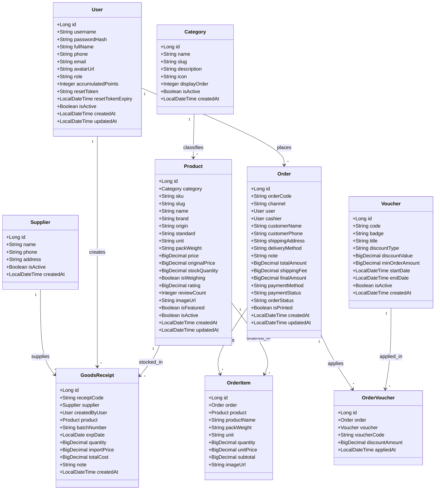

---

## 2.4. Lưu đồ xử lý các chức năng chính

Hệ thống bao gồm đầy đủ **10 lưu đồ quy trình nghiệp vụ** chi tiết mô tả luồng dữ liệu, điều kiện kiểm tra và các điểm giao dịch trong ứng dụng:

#### 1. Lưu đồ Quy trình Đăng nhập & Xác thực JWT Token (Login & Authentication)
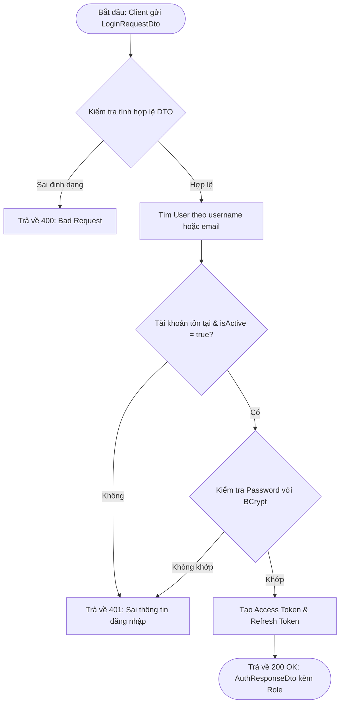

#### 2. Lưu đồ Quy trình Đăng ký tài khoản mới (User Registration)
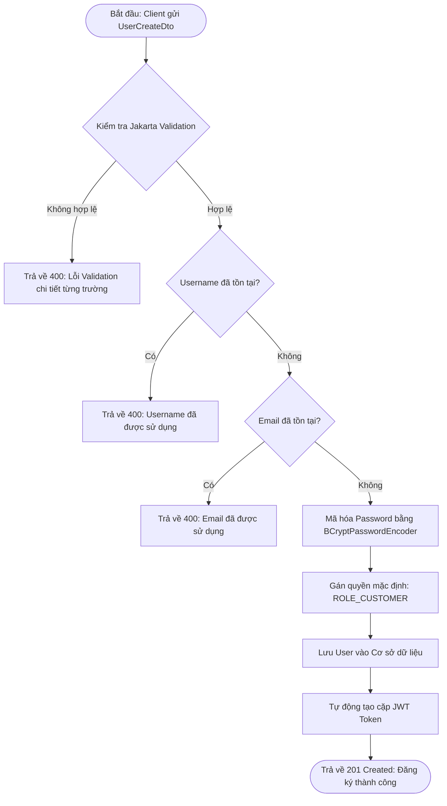

#### 3. Lưu đồ Quy trình Quên mật khẩu & Đặt lại mật khẩu qua Email OTP (Forgot & Reset Password)
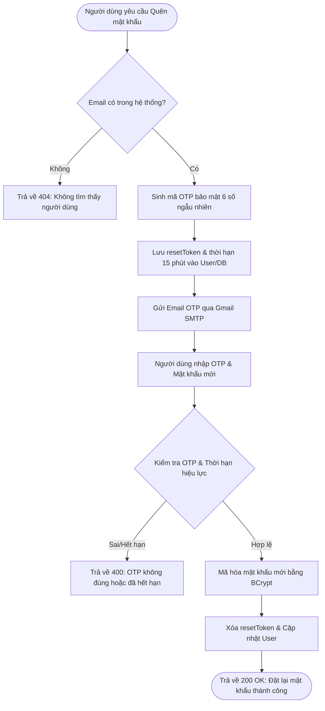

#### 4. Lưu đồ Quy trình Thêm mới & Cập nhật Sản phẩm kèm Upload ảnh Cloudinary
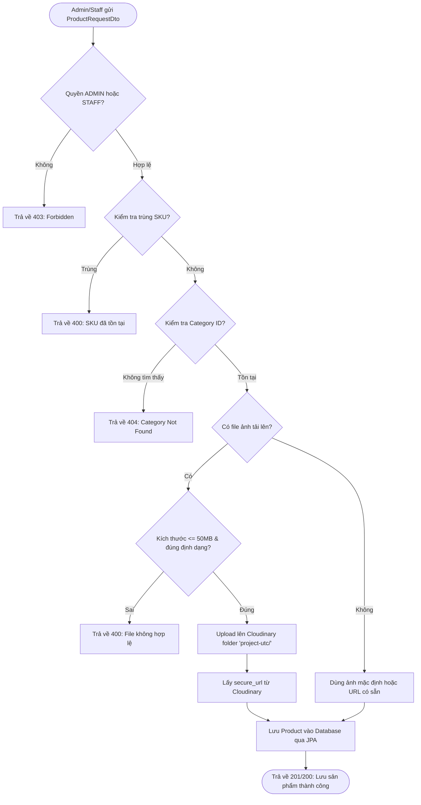

#### 5. Lưu đồ Quy trình Tìm kiếm, Lọc danh mục & Cảnh báo tồn kho
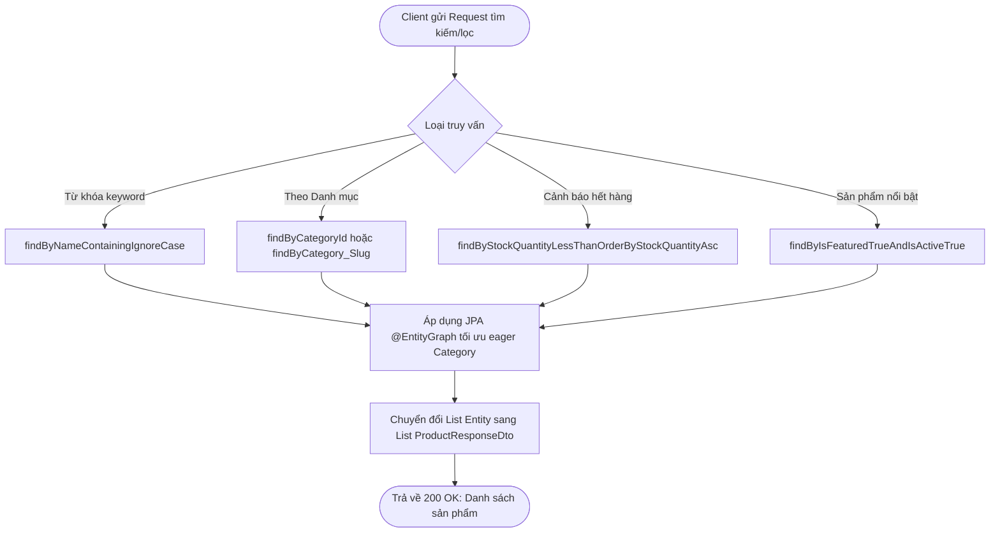

#### 6. Lưu đồ Quy trình Kiểm tra & Áp dụng Voucher giảm giá (Voucher Validation)
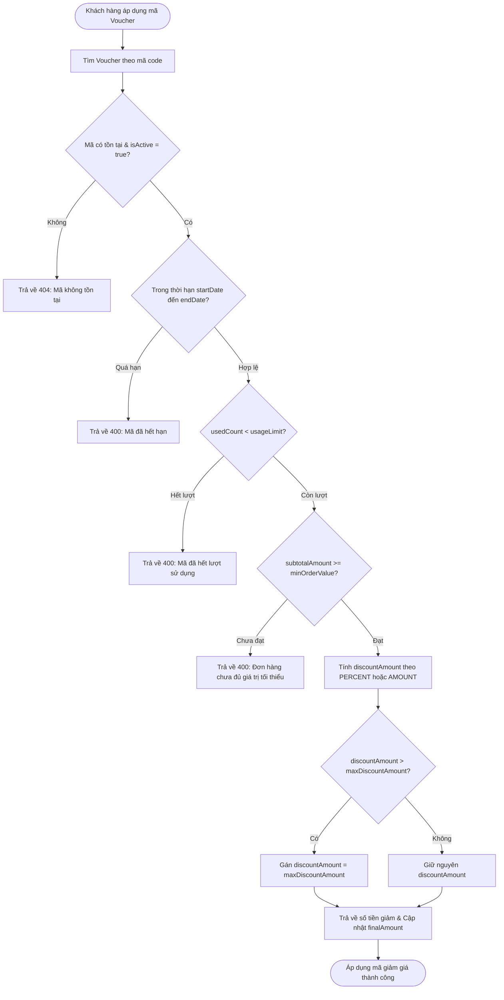

#### 7. Lưu đồ Quy trình Tạo Đơn hàng & Trừ tồn kho (Order Creation & Inventory Deduction)
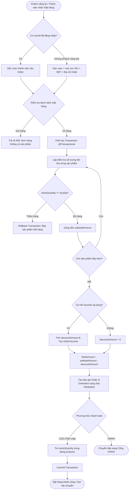

#### 8. Lưu đồ Quy trình Thanh toán Trực tuyến qua Cổng VNPAY (VNPAY Gateway & IPN Callback)
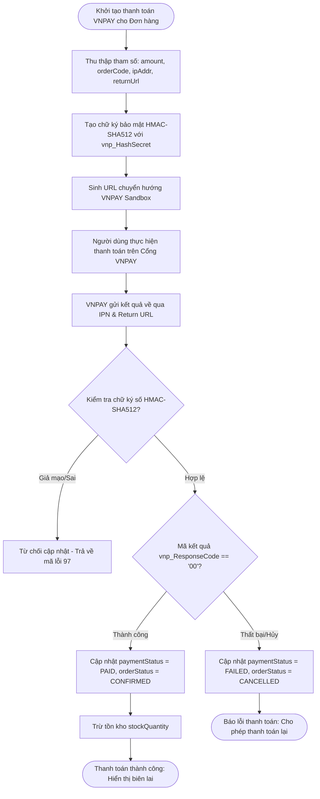

#### 9. Lưu đồ Quy trình Quản lý Trạng thái Đơn hàng (Order Lifecycle Management)
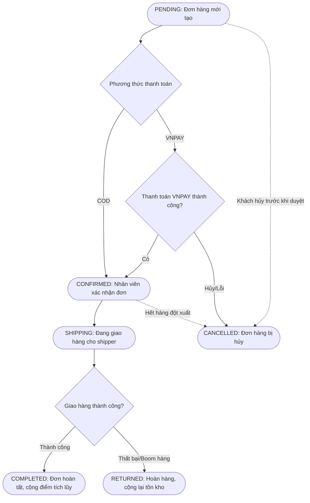

#### 10. Lưu đồ Quy trình Lập phiếu Nhập kho hàng hóa (`GoodsReceipt`) từ Nhà cung cấp
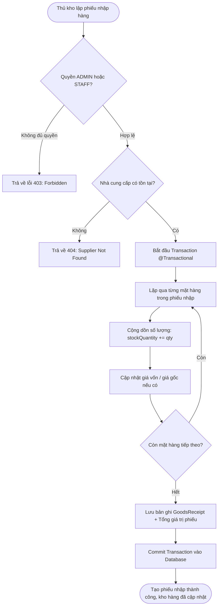

---

## 2.5. Thiết kế Cơ sở dữ liệu và mã nguồn dbdiagram

Hệ thống cơ sở dữ liệu quan hệ được thiết kế chuẩn hóa mức 3 (3NF) gồm **9 bảng thực thể** liên kết chặt chẽ:

### 1. Bảng mô tả chi tiết các bảng trong Cơ sở dữ liệu

**Bảng 2.2: Cấu trúc chi tiết bảng `users` (Tài khoản & Người dùng)**
| Tên cột | Kiểu dữ liệu | Ràng buộc | Ý nghĩa / Mô tả |
| :--- | :--- | :--- | :--- |
| `id` | `BIGINT` | `PK, AUTO_INCREMENT` | Định danh duy nhất của người dùng |
| `username` | `VARCHAR(50)` | `NOT NULL, UNIQUE` | Tên đăng nhập hệ thống |
| `password_hash` | `VARCHAR(255)` | `NOT NULL` | Mật khẩu mã hóa một chiều bằng BCrypt |
| `full_name` | `VARCHAR(100)` | `NOT NULL` | Họ và tên đầy đủ |
| `phone` | `VARCHAR(20)` | `UNIQUE` | Số điện thoại liên hệ |
| `email` | `VARCHAR(100)` | `UNIQUE` | Địa chỉ email (dùng nhận OTP đổi mật khẩu) |
| `avatar_url` | `VARCHAR(500)` | `NULL` | Đường dẫn ảnh đại diện trên Cloudinary |
| `role` | `VARCHAR(20)` | `NOT NULL, DEFAULT 'CUSTOMER'` | Vai trò: `ADMIN`, `STAFF`, `CUSTOMER` |
| `accumulated_points` | `INT` | `DEFAULT 0` | Điểm thưởng tích lũy khi mua hàng |
| `reset_token` | `VARCHAR(100)` | `NULL` | Mã OTP / Token đặt lại mật khẩu |
| `reset_token_expiry` | `DATETIME` | `NULL` | Thời hạn hiệu lực của mã OTP (15 phút) |
| `is_active` | `BOOLEAN` | `DEFAULT TRUE` | Trạng thái tài khoản (Đang hoạt động / Khóa) |
| `created_at` | `DATETIME` | `DEFAULT CURRENT_TIMESTAMP` | Thời điểm tạo tài khoản |
| `updated_at` | `DATETIME` | `ON UPDATE CURRENT_TIMESTAMP` | Thời điểm cập nhật hồ sơ gần nhất |

**Bảng 2.3: Cấu trúc chi tiết bảng `categories` (Danh mục ngành hàng)**
| Tên cột | Kiểu dữ liệu | Ràng buộc | Ý nghĩa / Mô tả |
| :--- | :--- | :--- | :--- |
| `id` | `BIGINT` | `PK, AUTO_INCREMENT` | Định danh danh mục |
| `name` | `VARCHAR(100)` | `NOT NULL, UNIQUE` | Tên danh mục (Thịt tươi, Rau củ, v.v.) |
| `slug` | `VARCHAR(120)` | `NOT NULL, UNIQUE` | Đường dẫn thân thiện SEO (thit-tuoi-sach) |
| `icon` | `VARCHAR(50)` | `NULL` | Tên icon giao diện đại diện danh mục |
| `description` | `TEXT` | `NULL` | Mô tả chi tiết danh mục |
| `display_order` | `INT` | `DEFAULT 0` | Thứ tự ưu tiên hiển thị trên trang chủ |
| `is_active` | `BOOLEAN` | `DEFAULT TRUE` | Trạng thái kích hoạt |
| `created_at` | `DATETIME` | `DEFAULT CURRENT_TIMESTAMP` | Thời điểm tạo danh mục |

**Bảng 2.4: Cấu trúc chi tiết bảng `products` (Thông tin sản phẩm & Tồn kho)**
| Tên cột | Kiểu dữ liệu | Ràng buộc | Ý nghĩa / Mô tả |
| :--- | :--- | :--- | :--- |
| `id` | `BIGINT` | `PK, AUTO_INCREMENT` | Định danh sản phẩm |
| `category_id` | `BIGINT` | `NOT NULL, FK -> categories(id)` | Liên kết danh mục sản phẩm |
| `sku` | `VARCHAR(50)` | `NOT NULL, UNIQUE` | Mã vạch / Mã quản lý SKU duy nhất |
| `slug` | `VARCHAR(200)` | `NOT NULL, UNIQUE` | Đường dẫn SEO Friendly Slug của sản phẩm |
| `name` | `VARCHAR(200)` | `NOT NULL` | Tên sản phẩm |
| `brand` | `VARCHAR(100)` | `NULL` | Thương hiệu / Nhãn hàng sản xuất |
| `origin` | `VARCHAR(150)` | `NULL` | Nguồn gốc xuất xứ |
| `standard` | `VARCHAR(50)` | `DEFAULT 'vietgap'` | Tiêu chuẩn chất lượng (VietGAP, Organic...) |
| `unit` | `VARCHAR(30)` | `NOT NULL, DEFAULT 'Khay'` | Đơn vị tính (Khay, Hộp, Túi, Kg) |
| `pack_weight` | `VARCHAR(50)` | `NULL` | Quy cách đóng gói (Khay 300g, 500g, 1kg) |
| `price` | `DECIMAL(15,2)`| `NOT NULL` | Đơn giá niêm yết bán ra |
| `original_price` | `DECIMAL(15,2)`| `NULL` | Giá gốc trước khuyến mại |
| `stock_quantity` | `DECIMAL(12,3)`| `NOT NULL, DEFAULT 0` | Số lượng tồn kho hiện tại |
| `is_weighing` | `BOOLEAN` | `DEFAULT FALSE` | Hàng cân ký theo trọng lượng thực tế |
| `rating` | `DECIMAL(3,1)` | `DEFAULT 5.0` | Đánh giá sao trung bình (1.0 - 5.0) |
| `review_count` | `INT` | `DEFAULT 0` | Số lượt đánh giá từ khách hàng |
| `image_url` | `VARCHAR(500)` | `NULL` | Đường dẫn ảnh CDN trên Cloudinary |
| `is_active` | `BOOLEAN` | `DEFAULT TRUE` | Trạng thái kinh doanh |
| `created_at` | `DATETIME` | `DEFAULT CURRENT_TIMESTAMP` | Ngày tạo sản phẩm |
| `updated_at` | `DATETIME` | `ON UPDATE CURRENT_TIMESTAMP` | Ngày cập nhật gần nhất |

**Bảng 2.5: Cấu trúc chi tiết bảng `vouchers` (Mã giảm giá & Khuyến mại)**
| Tên cột | Kiểu dữ liệu | Ràng buộc | Ý nghĩa / Mô tả |
| :--- | :--- | :--- | :--- |
| `id` | `BIGINT` | `PK, AUTO_INCREMENT` | Định danh mã voucher |
| `code` | `VARCHAR(50)` | `NOT NULL, UNIQUE` | Mã code áp dụng (VD: UTC2026, FREESHIP) |
| `badge` | `VARCHAR(50)` | `NULL` | Nhãn nổi bật hiển thị (VD: Giảm 20k) |
| `title` | `VARCHAR(150)` | `NOT NULL` | Tiêu đề chương trình khuyến mãi |
| `discount_type` | `VARCHAR(20)` | `NOT NULL` | Loại chiết khấu: `PERCENT` hoặc `AMOUNT` |
| `discount_value`| `DECIMAL(15,2)`| `NOT NULL` | Giá trị chiết khấu (% hoặc số tiền VNĐ) |
| `min_order_amount`| `DECIMAL(15,2)`| `DEFAULT 0` | Giá trị đơn hàng tối thiểu để áp dụng |
| `start_date` | `DATETIME` | `NOT NULL` | Ngày bắt đầu áp dụng |
| `end_date` | `DATETIME` | `NOT NULL` | Ngày hết hạn |
| `is_active` | `BOOLEAN` | `DEFAULT TRUE` | Trạng thái kích hoạt |
| `created_at` | `DATETIME` | `DEFAULT CURRENT_TIMESTAMP` | Ngày khởi tạo mã |

**Bảng 2.6: Cấu trúc chi tiết bảng `orders` (Đơn đặt hàng & Bán hàng)**
| Tên cột | Kiểu dữ liệu | Ràng buộc | Ý nghĩa / Mô tả |
| :--- | :--- | :--- | :--- |
| `id` | `BIGINT` | `PK, AUTO_INCREMENT` | Định danh đơn hàng |
| `order_code` | `VARCHAR(50)` | `NOT NULL, UNIQUE` | Mã đơn hàng sinh tự động (VD: ORD-20260408) |
| `channel` | `VARCHAR(20)` | `NOT NULL, DEFAULT 'WEB'` | Kênh bán lẻ: `WEB`, `POS` quầy |
| `user_id` | `BIGINT` | `NULL, FK -> users(id)` | Tài khoản khách hàng đặt đơn |
| `cashier_id` | `BIGINT` | `NULL, FK -> users(id)` | Thu ngân/Nhân viên tạo đơn (nếu mua tại quầy) |
| `customer_name` | `VARCHAR(100)` | `NOT NULL` | Tên người nhận hàng |
| `customer_phone`| `VARCHAR(20)` | `NULL` | Số điện thoại người nhận hàng |
| `shipping_address`| `VARCHAR(255)`| `NULL` | Địa chỉ nhận hàng |
| `delivery_method`| `VARCHAR(30)` | `DEFAULT 'FAST_2H'` | Phương thức giao hàng (Nhanh 2h, Hẹn giờ) |
| `note` | `TEXT` | `NULL` | Ghi chú của khách hàng khi đặt |
| `total_amount` | `DECIMAL(15,2)`| `NOT NULL` | Tổng tiền hàng ban đầu (subtotal) |
| `shipping_fee` | `DECIMAL(15,2)`| `DEFAULT 0` | Phí vận chuyển |
| `final_amount` | `DECIMAL(15,2)`| `NOT NULL` | Tổng tiền thanh toán sau trừ voucher |
| `payment_method`| `VARCHAR(30)` | `NOT NULL, DEFAULT 'COD'` | Hình thức: `COD` (Tiền mặt), `VNPAY` |
| `payment_status`| `VARCHAR(30)` | `DEFAULT 'PENDING'` | Trạng thái thanh toán: `PENDING`, `PAID`, `FAILED` |
| `order_status` | `VARCHAR(30)` | `NOT NULL, DEFAULT 'PENDING'` | Vòng đời đơn: `PENDING`, `CONFIRMED`, `SHIPPING`, `COMPLETED`, `CANCELLED` |
| `is_printed` | `BOOLEAN` | `DEFAULT FALSE` | Đã in hóa đơn nhiệt hay chưa |
| `printed_at` | `DATETIME` | `NULL` | Thời điểm in phiếu giao hàng |
| `created_at` | `DATETIME` | `DEFAULT CURRENT_TIMESTAMP` | Thời điểm khách đặt đơn |
| `updated_at` | `DATETIME` | `ON UPDATE CURRENT_TIMESTAMP` | Thời điểm cập nhật đơn |

**Bảng 2.7: Cấu trúc chi tiết bảng `order_items` (Chi tiết các mặt hàng trong đơn)**
| Tên cột | Kiểu dữ liệu | Ràng buộc | Ý nghĩa / Mô tả |
| :--- | :--- | :--- | :--- |
| `id` | `BIGINT` | `PK, AUTO_INCREMENT` | Định danh dòng chi tiết |
| `order_id` | `BIGINT` | `NOT NULL, FK -> orders(id)` | Liên kết đơn hàng cha |
| `product_id` | `BIGINT` | `NOT NULL, FK -> products(id)` | Liên kết sản phẩm |
| `product_name` | `VARCHAR(200)` | `NOT NULL` | Tên sản phẩm tại thời điểm mua |
| `pack_weight` | `VARCHAR(50)` | `NULL` | Quy cách đóng gói lúc mua |
| `unit` | `VARCHAR(30)` | `NOT NULL` | Đơn vị tính |
| `quantity` | `DECIMAL(12,3)`| `NOT NULL` | Số lượng đặt mua |
| `unit_price` | `DECIMAL(15,2)`| `NOT NULL` | Đơn giá tại thời điểm chốt đơn |
| `subtotal` | `DECIMAL(15,2)`| `NOT NULL` | Thành tiền (`quantity * unit_price`) |
| `image_url` | `VARCHAR(500)` | `NULL` | Ảnh sản phẩm lúc mua |

**Bảng 2.8: Cấu trúc chi tiết bảng `order_vouchers` (Lịch sử áp dụng Voucher theo đơn)**
| Tên cột | Kiểu dữ liệu | Ràng buộc | Ý nghĩa / Mô tả |
| :--- | :--- | :--- | :--- |
| `id` | `BIGINT` | `PK, AUTO_INCREMENT` | Định danh bản ghi chiết khấu |
| `order_id` | `BIGINT` | `NOT NULL, FK -> orders(id)` | Liên kết đơn hàng |
| `voucher_id` | `BIGINT` | `NULL, FK -> vouchers(id)` | Liên kết voucher |
| `voucher_code` | `VARCHAR(50)` | `NOT NULL` | Mã code đã áp dụng |
| `discount_amount`| `DECIMAL(15,2)`| `NOT NULL` | Số tiền thực tế được trừ vào đơn hàng |
| `applied_at` | `DATETIME` | `DEFAULT CURRENT_TIMESTAMP` | Thời điểm áp dụng |

**Bảng 2.9: Cấu trúc chi tiết bảng `suppliers` (Nhà cung cấp hàng hóa)**
| Tên cột | Kiểu dữ liệu | Ràng buộc | Ý nghĩa / Mô tả |
| :--- | :--- | :--- | :--- |
| `id` | `BIGINT` | `PK, AUTO_INCREMENT` | Định danh nhà cung cấp |
| `name` | `VARCHAR(150)` | `NOT NULL` | Tên công ty / cơ sở cung ứng |
| `phone` | `VARCHAR(20)` | `NULL` | Số điện thoại liên hệ |
| `address` | `VARCHAR(255)` | `NULL` | Địa chỉ kho hàng / trụ sở nhà cung cấp |
| `is_active` | `BOOLEAN` | `DEFAULT TRUE` | Trạng thái hợp tác |
| `created_at` | `DATETIME` | `DEFAULT CURRENT_TIMESTAMP` | Ngày tạo bản ghi |

**Bảng 2.10: Cấu trúc chi tiết bảng `goods_receipts` (Phiếu nhập kho hàng hóa)**
| Tên cột | Kiểu dữ liệu | Ràng buộc | Ý nghĩa / Mô tả |
| :--- | :--- | :--- | :--- |
| `id` | `BIGINT` | `PK, AUTO_INCREMENT` | Định danh phiếu nhập |
| `receipt_code` | `VARCHAR(50)` | `NOT NULL, UNIQUE` | Mã phiếu nhập kho (VD: PNK-20261012-001) |
| `supplier_id` | `BIGINT` | `NOT NULL, FK -> suppliers(id)` | Nhà cung cấp xuất hàng |
| `created_by` | `BIGINT` | `NOT NULL, FK -> users(id)` | Nhân viên / Thủ kho lập phiếu |
| `product_id` | `BIGINT` | `NOT NULL, FK -> products(id)` | Sản phẩm nhập kho |
| `batch_number` | `VARCHAR(50)` | `NULL` | Số lô sản xuất / kiểm định |
| `exp_date` | `DATE` | `NULL` | Hạn sử dụng của lô hàng |
| `quantity` | `DECIMAL(12,3)`| `NOT NULL` | Số lượng nhập kho |
| `import_price` | `DECIMAL(15,2)`| `NOT NULL` | Đơn giá nhập vào |
| `total_cost` | `DECIMAL(15,2)`| `NOT NULL` | Tổng chi phí nhập hàng (`quantity * import_price`) |
| `note` | `TEXT` | `NULL` | Ghi chú tình trạng nhập hàng |
| `created_at` | `DATETIME` | `DEFAULT CURRENT_TIMESTAMP` | Ngày lập phiếu |

---

### 2. Mã nguồn DBML hoàn chỉnh cho dbdiagram.io

> **Hướng dẫn sử dụng:** Truy cập trang web **[https://dbdiagram.io](https://dbdiagram.io)**, tạo biểu đồ mới và dán toàn bộ đoạn mã DBML dưới đây để hệ thống tự động sinh ra sơ đồ thực thể liên kết (ERD) trực quan:

```dbml
// ============================================================================
// DBML SCHEMA FOR PROJECT UTC - GENERATED FOR DBDATABASE.IO / DBDiagram
// ============================================================================

Table users {
  id bigint [pk, increment, note: 'Khóa chính định danh tài khoản']
  username varchar(50) [not null, unique, note: 'Tên đăng nhập hệ thống']
  password_hash varchar(255) [not null, note: 'Mật khẩu mã hóa BCrypt']
  full_name varchar(100) [not null, note: 'Họ tên đầy đủ người dùng']
  phone varchar(20) [unique, note: 'Số điện thoại']
  email varchar(100) [unique, note: 'Email nhận OTP']
  avatar_url varchar(500) [note: 'Link ảnh đại diện Cloudinary']
  role varchar(20) [not null, default: 'CUSTOMER', note: 'ADMIN, STAFF, CUSTOMER']
  accumulated_points int [default: 0, note: 'Điểm tích lũy khi mua sắm']
  reset_token varchar(100) [note: 'Mã OTP khôi phục mật khẩu']
  reset_token_expiry datetime [note: 'Thời hạn hết hạn của OTP']
  is_active boolean [default: true, note: 'Trạng thái hoạt động']
  created_at datetime [default: `now()`]
  updated_at datetime
}

Table categories {
  id bigint [pk, increment]
  name varchar(100) [not null, unique, note: 'Tên danh mục phân loại']
  slug varchar(120) [not null, unique, note: 'Đường dẫn SEO slug']
  icon varchar(50) [note: 'Icon hiển thị danh mục']
  description text [note: 'Mô tả chi tiết']
  display_order int [default: 0]
  is_active boolean [default: true]
  created_at datetime [default: `now()`]
}

Table products {
  id bigint [pk, increment]
  category_id bigint [not null, note: 'FK liên kết tới categories']
  sku varchar(50) [not null, unique, note: 'Mã vạch SKU duy nhất']
  slug varchar(200) [not null, unique, note: 'Đường dẫn thân thiện SEO']
  name varchar(200) [not null, note: 'Tên sản phẩm']
  brand varchar(100) [note: 'Thương hiệu']
  origin varchar(150) [note: 'Xuất xứ']
  standard varchar(50) [default: 'vietgap', note: 'VietGAP, Organic...']
  unit varchar(30) [not null, default: 'Khay', note: 'Đơn vị tính']
  pack_weight varchar(50) [note: 'Quy cách đóng gói']
  price decimal(15,2) [not null, note: 'Giá bán niêm yết']
  original_price decimal(15,2) [note: 'Giá gốc trước giảm']
  stock_quantity decimal(12,3) [not null, default: 0, note: 'Số lượng tồn kho']
  is_weighing boolean [default: false, note: 'Có cân ký hay không']
  rating decimal(3,1) [default: 5.0, note: 'Đánh giá trung bình']
  review_count int [default: 0, note: 'Số lượt đánh giá']
  image_url varchar(500) [note: 'Đường dẫn ảnh Cloudinary']
  is_active boolean [default: true]
  created_at datetime [default: `now()`]
  updated_at datetime
}

Table vouchers {
  id bigint [pk, increment]
  code varchar(50) [not null, unique, note: 'Mã code áp dụng']
  badge varchar(50) [note: 'Huy hiệu giảm giá hiển thị']
  title varchar(150) [not null, note: 'Tiêu đề khuyến mãi']
  discount_type varchar(20) [not null, note: 'PERCENT hoặc AMOUNT']
  discount_value decimal(15,2) [not null, note: 'Mức giảm']
  min_order_amount decimal(15,2) [default: 0, note: 'Đơn hàng tối thiểu']
  start_date datetime [not null, note: 'Ngày bắt đầu']
  end_date datetime [not null, note: 'Ngày kết thúc']
  is_active boolean [default: true]
  created_at datetime [default: `now()`]
}

Table orders {
  id bigint [pk, increment]
  order_code varchar(50) [not null, unique, note: 'Mã đơn hàng duy nhất']
  channel varchar(20) [not null, default: 'WEB', note: 'Kênh bán: WEB / POS']
  user_id bigint [note: 'FK liên kết tới khách hàng']
  cashier_id bigint [note: 'FK liên kết nhân viên thu ngân']
  customer_name varchar(100) [not null, note: 'Tên người nhận']
  customer_phone varchar(20) [note: 'SĐT người nhận']
  shipping_address varchar(255) [note: 'Địa chỉ nhận hàng']
  delivery_method varchar(30) [default: 'FAST_2H', note: 'Giao hàng nhanh 2h']
  note text [note: 'Ghi chú đơn hàng']
  total_amount decimal(15,2) [not null, note: 'Tổng tiền hàng gốc']
  shipping_fee decimal(15,2) [default: 0, note: 'Phí ship']
  final_amount decimal(15,2) [not null, note: 'Số tiền thanh toán cuối cùng']
  payment_method varchar(30) [not null, default: 'COD', note: 'COD, VNPAY']
  payment_status varchar(30) [default: 'PENDING', note: 'PENDING, PAID, FAILED']
  order_status varchar(30) [not null, default: 'PENDING', note: 'PENDING, CONFIRMED, SHIPPING, COMPLETED, CANCELLED']
  is_printed boolean [default: false, note: 'Đã in phiếu hay chưa']
  printed_at datetime
  created_at datetime [default: `now()`]
  updated_at datetime
}

Table order_items {
  id bigint [pk, increment]
  order_id bigint [not null, note: 'FK liên kết tới orders']
  product_id bigint [not null, note: 'FK liên kết tới products']
  product_name varchar(200) [not null, note: 'Tên mặt hàng']
  pack_weight varchar(50) [note: 'Quy cách']
  unit varchar(30) [not null, note: 'Đơn vị tính']
  quantity decimal(12,3) [not null, note: 'Số lượng mua']
  unit_price decimal(15,2) [not null, note: 'Đơn giá mua']
  subtotal decimal(15,2) [not null, note: 'Thành tiền dòng']
  image_url varchar(500)
}

Table order_vouchers {
  id bigint [pk, increment]
  order_id bigint [not null, note: 'FK liên kết tới orders']
  voucher_id bigint [note: 'FK liên kết tới vouchers']
  voucher_code varchar(50) [not null, note: 'Mã code áp dụng']
  discount_amount decimal(15,2) [not null, note: 'Số tiền thực tế được giảm']
  applied_at datetime [default: `now()`]
}

Table suppliers {
  id bigint [pk, increment]
  name varchar(150) [not null, note: 'Tên nhà cung cấp']
  phone varchar(20) [note: 'SĐT nhà cung cấp']
  address varchar(255) [note: 'Địa chỉ kho NCC']
  is_active boolean [default: true]
  created_at datetime [default: `now()`]
}

Table goods_receipts {
  id bigint [pk, increment]
  receipt_code varchar(50) [not null, unique, note: 'Mã phiếu nhập']
  supplier_id bigint [not null, note: 'FK liên kết tới suppliers']
  created_by bigint [not null, note: 'FK liên kết tới users (thủ kho)']
  product_id bigint [not null, note: 'FK liên kết tới products']
  batch_number varchar(50) [note: 'Số lô kiểm định']
  exp_date date [note: 'Hạn dùng lô hàng']
  quantity decimal(12,3) [not null, note: 'Số lượng nhập']
  import_price decimal(15,2) [not null, note: 'Đơn giá nhập vào']
  total_cost decimal(15,2) [not null, note: 'Tổng tiền phiếu nhập']
  note text [note: 'Ghi chú phiếu nhập']
  created_at datetime [default: `now()`]
}

// ----------------------------------------------------------------------------
// KHAI BÁO CÁC MỐI QUAN HỆ (RELATIONSHIPS)
// ----------------------------------------------------------------------------
Ref: products.category_id > categories.id
Ref: orders.user_id > users.id
Ref: orders.cashier_id > users.id
Ref: order_items.order_id > orders.id
Ref: order_items.product_id > products.id
Ref: order_vouchers.order_id > orders.id
Ref: order_vouchers.voucher_id > vouchers.id
Ref: goods_receipts.supplier_id > suppliers.id
Ref: goods_receipts.created_by > users.id
Ref: goods_receipts.product_id > products.id
```

---

## 2.6. Thiết kế Giao diện dự kiến

Phần này bao gồm hệ thống các màn hình giao diện người dùng dự kiến của hệ thống, được phân chia theo các phân hệ chính: **Phân hệ Khách hàng (Customer Web)**, **Phân hệ Xác thực (Authentication)** và **Phân hệ Quản trị (Admin Portal)**.

*(Bạn có thể dán trực tiếp ảnh screenshot vào các khung minh họa bên dưới)*

#### 1. Phân hệ Khách hàng (Customer Web Application)

##### a. Giao diện Trang chủ (Home Page)
* **Mô tả:** Hiển thị thanh Header tìm kiếm thông minh, danh mục sản phẩm nổi bật, banner chương trình khuyến mại trượt tự động (Hero Carousel), danh sách sản phẩm bán chạy và cam kết chất lượng.
* 🖼️ **Hình ảnh minh họa:**
  > 
  *(Dán link ảnh screenshot trang chủ vào đây)*

##### b. Giao diện Danh mục & Bộ lọc sản phẩm (Product Catalog & Filter)
* **Mô tả:** Phân loại sản phẩm theo danh mục sidebar bên trái, bộ lọc đa tiêu chí theo khoảng giá, tiêu chuẩn VietGAP/Organic, sắp xếp theo giá tăng/giảm và phân trang sản phẩm.
* 🖼️ **Hình ảnh minh họa:**
  > 
  *(Dán link ảnh screenshot danh mục và bộ lọc sản phẩm vào đây)*

##### c. Giao diện Chi tiết sản phẩm (Product Detail Page)
* **Mô tả:** Trình chiếu hình ảnh sản phẩm độ phân giải cao qua Cloudinary, thông tin xuất xứ, tiêu chuẩn đóng gói, giá niêm yết, chọn số lượng và nút "Thêm vào giỏ hàng" hoặc "Mua ngay".
* 🖼️ **Hình ảnh minh họa:**
  > 
  *(Dán link ảnh screenshot chi tiết sản phẩm vào đây)*

##### d. Giao diện Giỏ hàng & Áp dụng Voucher (Shopping Cart)
* **Mô tả:** Danh sách các mặt hàng đã chọn, điều chỉnh số lượng theo thời gian thực, nhập và kiểm tra mã voucher chiết khấu, hiển thị tạm tính và tổng tiền phải trả.
* 🖼️ **Hình ảnh minh họa:**
  > 
  *(Dán link ảnh screenshot giỏ hàng và áp dụng voucher vào đây)*

##### e. Giao diện Đặt hàng & Thanh toán VNPAY Sandbox (Checkout & Payment)
* **Mô tả:** Biểu mẫu điền thông tin người nhận, địa chỉ giao hàng, phương thức vận chuyển nhanh 2H, lựa chọn thanh toán Tiền mặt (COD) hoặc Cổng VNPAY (quét mã QR ngân hàng).
* 🖼️ **Hình ảnh minh họa:**
  > 
  *(Dán link ảnh screenshot trang đặt hàng và cổng thanh toán vào đây)*

---

#### 2. Phân hệ Xác thực & Quản lý Tài khoản (Auth & Profile)

##### a. Giao diện Đăng nhập & Đăng ký (Login & Register Modal/Page)
* **Mô tả:** Biểu mẫu đăng ký/đăng nhập trực quan với kiểm tra dữ liệu đầu vào thời gian thực, hỗ trợ ghi nhớ phiên đăng nhập và chuyển hướng phân quyền vai trò.
* 🖼️ **Hình ảnh minh họa:**
  > 
  *(Dán link ảnh screenshot màn hình đăng nhập/đăng ký vào đây)*

##### b. Giao diện Quên mật khẩu & Xác nhận OTP qua Email
* **Mô tả:** Nhập địa chỉ email đăng ký để nhận mã OTP 6 chữ số gửi tự động qua Gmail SMTP, form nhập mã xác thực và thiết lập mật khẩu mới an toàn.
* 🖼️ **Hình ảnh minh họa:**
  > 
  *(Dán link ảnh screenshot màn hình quên mật khẩu OTP vào đây)*

---

#### 3. Phân hệ Quản trị viên & Nhân viên (Admin & Staff Management)

##### a. Giao diện Quản lý Danh mục & Sản phẩm (Admin Product Management)
* **Mô tả:** Bảng danh sách sản phẩm với các chức năng thêm mới, chỉnh sửa, xóa mềm, cảnh báo lượng tồn kho dưới ngưỡng (`low-stock`) và modal upload hình ảnh trực tiếp lên Cloudinary.
* 🖼️ **Hình ảnh minh họa:**
  > 
  *(Dán link ảnh screenshot trang quản lý sản phẩm admin vào đây)*

##### b. Giao diện Lập phiếu Nhập kho hàng hóa (Goods Receipt Creation)
* **Mô tả:** Biểu mẫu chọn nhà cung cấp, thêm danh sách nhiều mặt hàng nhập theo số lượng và giá vốn, tự động tính tổng chi phí phiếu nhập và cập nhật tồn kho tức thì.
* 🖼️ **Hình ảnh minh họa:**
  > 
  *(Dán link ảnh screenshot form lập phiếu nhập kho vào đây)*

##### c. Giao diện Quản lý & Cập nhật Trạng thái Đơn hàng (Admin Orders Management)
* **Mô tả:** Bảng danh sách đơn hàng toàn hệ thống, lọc đơn theo trạng thái (`PENDING`, `CONFIRMED`, `SHIPPING`, `COMPLETED`, `CANCELLED`), xem chi tiết đơn và cập nhật tiến độ giao hàng.
* 🖼️ **Hình ảnh minh họa:**
  > 
  *(Dán link ảnh screenshot trang quản lý đơn hàng admin vào đây)*

---

# Chương 3. HIỆN THỰC HÓA & CÀI ĐẶT CÁC MODULE

Hệ thống được tổ chức thành **10 Module nghiệp vụ hoàn chỉnh**, mỗi module đảm nhiệm một chức năng chuyên biệt trong kiến trúc phân lớp (**Controller - Service - Repository - Entity/DTO**) và cung cấp đầy đủ các chuẩn RESTful API.

---

## 3.1. Module 1: Quản lý người dùng, tài khoản và xác thực (User & Authentication)

### 1. Mô tả nghiệp vụ
Module đảm nhiệm đăng ký tài khoản khách hàng, đăng nhập hệ thống, cấp phát và quản lý vòng đời JWT Token (Access Token 24h & Refresh Token 7 ngày), thay đổi mật khẩu, cấp lại mật khẩu qua email OTP bảo mật và phân quyền truy cập theo vai trò:
* `ROLE_ADMIN`: Toàn quyền quản trị hệ thống và người dùng.
* `ROLE_STAFF`: Nhân viên bán hàng & thủ kho.
* `ROLE_CUSTOMER`: Khách hàng mua sắm trực tuyến.

### 2. Cài đặt Thực thể & Record DTO
* **Entity:** `User` (bảng `users` ánh xạ các cột: `id`, `username`, `password_hash`, `full_name`, `phone`, `email`, `role`, `accumulated_points`, `reset_token`, `reset_token_expiry`, `is_active`).
* **Record DTO:** `UserCreateDto`, `UserUpdateDto`, `UserResponseDto`, `LoginRequestDto`, `AuthResponseDto`, `ChangePasswordRequestDto`, `ResetPasswordRequestDto`.

```java
// DTO đăng ký tài khoản sử dụng Java 21 Record và Jakarta Validation
public record UserCreateDto(
    @NotBlank(message = "Tên đăng nhập không được để trống")
    @Size(min = 3, max = 50, message = "Tên đăng nhập phải từ 3 đến 50 ký tự")
    String username,

    @NotBlank(message = "Mật khẩu không được để trống")
    @Size(min = 6, message = "Mật khẩu tối thiểu 6 ký tự")
    String password,

    @NotBlank(message = "Họ và tên không được để trống")
    String fullName,

    @Pattern(regexp = "^(0|\\+84)[0-9]{9}$", message = "Số điện thoại không đúng định dạng Việt Nam")
    String phone,

    @Email(message = "Email không đúng định dạng")
    String email,

    String role
) {}
```

### 3. Xử lý nghiệp vụ tại Service (`UserServiceImpl.java` & `AuthServiceImpl.java`)
* Mã hóa mật khẩu một chiều an toàn bằng thuật toán `BCryptPasswordEncoder`.
* Tự động tạo mã xác nhận OTP ngẫu nhiên 6 chữ số gửi qua Gmail SMTP khi khách hàng quên mật khẩu.

### 4. Danh sách API Endpoints Module 1

**Bảng 3.1: Danh sách API Endpoints Module 1 (Người dùng & Xác thực JWT)**
| STT | Phương thức | Đường dẫn API | Mô tả chức năng | Request Body / Params | Quyền hạn yêu cầu |
| :---: | :---: | :--- | :--- | :--- | :---: |
| 1 | `POST` | `/v1/auth/register` | Đăng ký tài khoản người dùng mới | `UserCreateDto` | Công khai (PermitAll) |
| 2 | `POST` | `/v1/auth/login` | Đăng nhập hệ thống, cấp Access & Refresh JWT Token | `LoginRequestDto` | Công khai (PermitAll) |
| 3 | `POST` | `/v1/auth/refresh-token` | Làm mới JWT Access Token khi token cũ hết hạn | `RefreshTokenRequestDto` | Công khai (PermitAll) |
| 4 | `POST` | `/v1/auth/logout` | Đăng xuất hệ thống | Header `Authorization` | Công khai (PermitAll) |
| 5 | `POST` | `/v1/auth/change-password` | Đổi mật khẩu tài khoản người dùng | `ChangePasswordRequestDto` | `Authenticated` |
| 6 | `POST` | `/v1/auth/forgot-password` | Gửi mã OTP xác nhận cấp lại mật khẩu qua Gmail | `?email={email}` | Công khai (PermitAll) |
| 7 | `POST` | `/v1/auth/reset-password` | Đặt lại mật khẩu mới thông qua mã OTP | `ResetPasswordRequestDto` | Công khai (PermitAll) |
| 8 | `POST` | `/v1/users` | Tạo mới người dùng nội bộ (Admin/Staff) | `UserCreateDto` | `ROLE_ADMIN` |
| 9 | `PUT` | `/v1/users/{id}` | Cập nhật thông tin hồ sơ người dùng | `UserUpdateDto` | `Authenticated` |
| 10 | `GET` | `/v1/users/{id}` | Xem chi tiết thông tin người dùng theo ID | Path `{id}` | `Authenticated` |
| 11 | `GET` | `/v1/users/username/{username}` | Tra cứu tài khoản theo Username | Path `{username}` | `Authenticated` |
| 12 | `GET` | `/v1/users` | Lấy danh sách tất cả tài khoản đang hoạt động | Không | `ROLE_ADMIN` |
| 13 | `DELETE`| `/v1/users/{id}` | Xóa mềm / Khóa tài khoản (`isActive = false`) | Path `{id}` | `ROLE_ADMIN` |

---

## 3.2. Module 2: Quản lý danh mục và sản phẩm (Category & Product Management)

### 1. Mô tả nghiệp vụ
Quản lý cây danh mục sản phẩm và toàn bộ vòng đời sản phẩm: mã vạch SKU duy nhất, tên sản phẩm, đường dẫn SEO Friendly Slug, thương hiệu, xuất xứ, tiêu chuẩn chất lượng (VietGAP, Organic), quy cách đóng gói, đơn giá bán, số lượng tồn kho và ảnh sản phẩm.

### 2. Cài đặt Thực thể & Record DTO
* **Entity:** `Category` (bảng `categories`), `Product` (bảng `products` liên kết `@ManyToOne` với `Category`).
* **Record DTO:** `CategoryRequestDto`, `CategoryResponseDto`, `ProductRequestDto`, `ProductResponseDto`.

```java
// DTO sản phẩm với ràng buộc chặt chẽ về giá và đơn vị tính
public record ProductRequestDto(
    @NotNull(message = "Danh mục không được để trống")
    Long categoryId,

    @NotBlank(message = "Mã SKU không được để trống")
    String sku,

    @NotBlank(message = "Tên sản phẩm không được để trống")
    String name,

    @NotNull(message = "Giá bán không được để trống")
    @DecimalMin(value = "0.0", inclusive = false, message = "Giá bán phải lớn hơn 0")
    BigDecimal price,

    @NotBlank(message = "Đơn vị tính không được để trống")
    String unit,

    String imageUrl
) {}
```

### 3. Xử lý nghiệp vụ tại Service (`ProductServiceImpl.java`)
* Áp dụng `@EntityGraph(attributePaths = {"category"})` trong `ProductRepository` để nạp sẵn dữ liệu danh mục, loại bỏ hoàn toàn hiện tượng trễ N+1 Query.
* Tự động sinh `slug` chuẩn URL từ tên sản phẩm hỗ trợ SEO.

### 4. Danh sách API Endpoints Module 2

**Bảng 3.2: Danh sách API Endpoints Module 2 (Danh mục & Sản phẩm)**
| STT | Phương thức | Đường dẫn API | Mô tả chức năng | Request Body / Params | Quyền hạn yêu cầu |
| :---: | :---: | :--- | :--- | :--- | :---: |
| 1 | `POST` | `/v1/categories` | Tạo mới danh mục hàng hóa | `CategoryRequestDto` | `ROLE_ADMIN` |
| 2 | `PUT` | `/v1/categories/{id}` | Cập nhật thông tin danh mục | `CategoryRequestDto` | `ROLE_ADMIN` |
| 3 | `GET` | `/v1/categories/{id}` | Lấy chi tiết danh mục theo ID | Path `{id}` | Công khai (PermitAll) |
| 4 | `GET` | `/v1/categories/slug/{slug}` | Lấy chi tiết danh mục theo Slug | Path `{slug}` | Công khai (PermitAll) |
| 5 | `GET` | `/v1/categories` | Lấy tất cả danh mục đang hoạt động | Không | Công khai (PermitAll) |
| 6 | `DELETE`| `/v1/categories/{id}` | Xóa mềm danh mục | Path `{id}` | `ROLE_ADMIN` |
| 7 | `POST` | `/v1/products` | Tạo mới sản phẩm | `ProductRequestDto` | `ROLE_ADMIN`, `ROLE_STAFF` |
| 8 | `PUT` | `/v1/products/{id}` | Cập nhật thông tin sản phẩm | `ProductRequestDto` | `ROLE_ADMIN`, `ROLE_STAFF` |
| 9 | `GET` | `/v1/products/{id}` | Lấy chi tiết sản phẩm theo ID | Path `{id}` | Công khai (PermitAll) |
| 10 | `GET` | `/v1/products/sku/{sku}` | Tra cứu sản phẩm theo mã vạch SKU | Path `{sku}` | Công khai (PermitAll) |
| 11 | `GET` | `/v1/products/slug/{slug}` | Tra cứu sản phẩm theo đường dẫn Slug | Path `{slug}` | Công khai (PermitAll) |
| 12 | `GET` | `/v1/products/category/{categoryId}` | Lấy sản phẩm theo mã ID danh mục | Path `{categoryId}` | Công khai (PermitAll) |
| 13 | `GET` | `/v1/products/category-slug/{categorySlug}` | Lấy sản phẩm theo Slug danh mục | Path `{categorySlug}` | Công khai (PermitAll) |
| 14 | `GET` | `/v1/products/search` | Tìm kiếm sản phẩm theo tên | `?keyword={kw}` | Công khai (PermitAll) |
| 15 | `GET` | `/v1/products/featured` | Lấy danh sách sản phẩm nổi bật | Không | Công khai (PermitAll) |
| 16 | `GET` | `/v1/products/low-stock` | Cảnh báo sản phẩm sắp hết hàng | `?threshold={val}` (default 60) | `ROLE_ADMIN`, `ROLE_STAFF` |
| 17 | `GET` | `/v1/products` | Lấy tất cả sản phẩm đang kinh doanh | Không | Công khai (PermitAll) |
| 18 | `DELETE`| `/v1/products/{id}` | Xóa mềm sản phẩm | Path `{id}` | `ROLE_ADMIN` |

---

## 3.3. Module 3: Quản lý nhà cung cấp và nhập kho hàng hóa (Supplier & Goods Receipt)

### 1. Mô tả nghiệp vụ
Quản lý các nhà cung ứng (`Supplier`) và quy trình nhập kho hàng hóa (`GoodsReceipt`). Mỗi phiếu nhập kho ghi nhận nhân viên tạo phiếu, nhà cung cấp, chi tiết danh sách mặt hàng, số lượng nhập và đơn giá nhập, tự động cộng dồn số lượng tồn kho `stockQuantity` trong bảng `products`.

### 2. Cài đặt Thực thể & Record DTO
* **Entity:** `Supplier` (bảng `suppliers`), `GoodsReceipt` (bảng `goods_receipts`), `GoodsReceiptDetail`.
* **Record DTO:** `SupplierRequestDto`, `SupplierResponseDto`, `GoodsReceiptRequestDto`, `GoodsReceiptResponseDto`.

```java
// DTO phiếu nhập kho hỗ trợ danh sách nhiều mặt hàng cùng lúc
public record GoodsReceiptRequestDto(
    @NotNull(message = "Nhà cung cấp không được để trống")
    Long supplierId,

    String note,

    @NotEmpty(message = "Danh sách mặt hàng nhập không được để trống")
    List<GoodsReceiptDetailDto> items
) {}
```

### 3. Xử lý nghiệp vụ tại Service (`GoodsReceiptServiceImpl.java`)
Quy trình nhập kho được bao bọc trong transaction toàn vẹn `@Transactional`:
```java
@Override
@Transactional
public GoodsReceiptResponseDto createGoodsReceipt(GoodsReceiptRequestDto dto, Long createdByUserId) {
    Supplier supplier = supplierRepository.findById(dto.supplierId())
            .orElseThrow(() -> new ResourceNotFoundException("Không tìm thấy NCC với ID: " + dto.supplierId()));
    User user = userRepository.findById(createdByUserId)
            .orElseThrow(() -> new ResourceNotFoundException("Không tìm thấy người dùng với ID: " + createdByUserId()));

    // Duyệt qua từng sản phẩm trong phiếu nhập để cộng dồn tồn kho
    for (var item : dto.items()) {
        Product product = productRepository.findById(item.productId())
                .orElseThrow(() -> new ResourceNotFoundException("Không tìm thấy sản phẩm"));
        product.setStockQuantity(product.getStockQuantity().add(item.quantity()));
        productRepository.save(product);
    }
    // Lưu GoodsReceipt và chi tiết phiếu nhập
    ...
}
```

### 4. Danh sách API Endpoints Module 3

**Bảng 3.3: Danh sách API Endpoints Module 3 (Nhà cung cấp & Nhập kho)**
| STT | Phương thức | Đường dẫn API | Mô tả chức năng | Request Body / Params | Quyền hạn yêu cầu |
| :---: | :---: | :--- | :--- | :--- | :---: |
| 1 | `POST` | `/v1/suppliers` | Thêm nhà cung cấp mới | `SupplierRequestDto` | `ROLE_ADMIN` |
| 2 | `PUT` | `/v1/suppliers/{id}` | Cập nhật thông tin nhà cung cấp | `SupplierRequestDto` | `ROLE_ADMIN` |
| 3 | `GET` | `/v1/suppliers/{id}` | Lấy chi tiết nhà cung cấp theo ID | Path `{id}` | `Authenticated` |
| 4 | `GET` | `/v1/suppliers` | Lấy tất cả nhà cung cấp đang hợp tác | Không | `Authenticated` |
| 5 | `DELETE`| `/v1/suppliers/{id}` | Xóa mềm nhà cung cấp | Path `{id}` | `ROLE_ADMIN` |
| 6 | `POST` | `/v1/goods-receipts` | Lập phiếu nhập kho từ Nhà cung cấp | `GoodsReceiptRequestDto`, `?createdByUserId=...` | `ROLE_ADMIN`, `ROLE_STAFF` |
| 7 | `GET` | `/v1/goods-receipts/{id}` | Lấy thông tin phiếu nhập kho theo ID | Path `{id}` | `ROLE_ADMIN`, `ROLE_STAFF` |
| 8 | `GET` | `/v1/goods-receipts/code/{receiptCode}` | Tra cứu phiếu nhập theo mã phiếu | Path `{receiptCode}` | `ROLE_ADMIN`, `ROLE_STAFF` |
| 9 | `GET` | `/v1/goods-receipts` | Lấy danh sách tất cả phiếu nhập kho | Không | `ROLE_ADMIN`, `ROLE_STAFF` |

---

## 3.4. Module 4: Quản lý mã giảm giá voucher (Voucher Management)

### 1. Mô tả nghiệp vụ
Khởi tạo và áp dụng các chiến dịch mã giảm giá cho đơn hàng. Hỗ trợ 2 phương thức chiết khấu: theo phần trăm (`PERCENT`) có chặn trần tối đa (`maxDiscountAmount`) hoặc số tiền trực tiếp (`AMOUNT`). Hệ thống tự động kiểm tra thời hạn sử dụng, ngưỡng đơn hàng tối thiểu và giới hạn số lượt sử dụng.

### 2. Cài đặt Thực thể & Record DTO
* **Entity:** `Voucher` (bảng `vouchers`), `OrderVoucher` (bảng `order_vouchers` ghi nhận liên kết đơn hàng).
* **Record DTO:** `VoucherRequestDto`, `VoucherResponseDto`.

### 3. Danh sách API Endpoints Module 4

**Bảng 3.4: Danh sách API Endpoints Module 4 (Mã giảm giá Voucher)**
| STT | Phương thức | Đường dẫn API | Mô tả chức năng | Request Body / Params | Quyền hạn yêu cầu |
| :---: | :---: | :--- | :--- | :--- | :---: |
| 1 | `POST` | `/v1/vouchers` | Tạo mã voucher khuyến mãi mới | `VoucherRequestDto` | `ROLE_ADMIN` |
| 2 | `GET` | `/v1/vouchers` | Lấy danh sách tất cả voucher đang hoạt động | Không | Công khai (PermitAll) |
| 3 | `GET` | `/v1/vouchers/{code}` | Kiểm tra và áp dụng mã voucher hợp lệ | Path `{code}` | Công khai (PermitAll) |
| 4 | `DELETE`| `/v1/vouchers/{id}` | Vô hiệu hóa voucher | Path `{id}` | `ROLE_ADMIN` |

---

## 3.5. Module 5: Quản lý đơn hàng và bán hàng (Order Management)

### 1. Mô tả nghiệp vụ
Tiếp nhận đơn đặt hàng từ khách hàng, tính toán tạm tính (`subtotalAmount`), chiết khấu voucher (`discountAmount`) và tổng tiền thanh toán (`finalAmount`). Kiểm tra số lượng tồn kho của từng món hàng trong kho, trừ kho an toàn, lưu vết các mặt hàng trong `order_items` và quản lý vòng đời trạng thái đơn hàng (`PENDING`, `CONFIRMED`, `SHIPPING`, `COMPLETED`, `CANCELLED`).

### 2. Cài đặt Thực thể & Record DTO
* **Entity:** `Order` (bảng `orders`), `OrderItem` (bảng `order_items`).
* **Record DTO:** `OrderRequestDto`, `OrderItemRequestDto`, `OrderResponseDto`, `OrderItemResponseDto`.

```java
// DTO yêu cầu đặt hàng của khách hàng
public record OrderRequestDto(
    @NotNull(message = "ID khách hàng không được để trống")
    Long userId,

    @NotBlank(message = "Tên người nhận không được để trống")
    String recipientName,

    @NotBlank(message = "Số điện thoại không được để trống")
    String recipientPhone,

    @NotBlank(message = "Địa chỉ giao hàng không được để trống")
    String shippingAddress,

    String paymentMethod, // COD, VNPAY

    String voucherCode,

    @NotEmpty(message = "Đơn hàng phải có ít nhất 1 sản phẩm")
    List<OrderItemRequestDto> items
) {}
```

### 3. Danh sách API Endpoints Module 5

**Bảng 3.5: Danh sách API Endpoints Module 5 (Đơn hàng & Bán hàng)**
| STT | Phương thức | Đường dẫn API | Mô tả chức năng | Request Body / Params | Quyền hạn yêu cầu |
| :---: | :---: | :--- | :--- | :--- | :---: |
| 1 | `POST` | `/v1/orders` | Khởi tạo đơn hàng mới | `OrderRequestDto` | `Authenticated` |
| 2 | `GET` | `/v1/orders/{id}` | Xem thông tin chi tiết đơn hàng theo ID | Path `{id}` | `Authenticated` |
| 3 | `GET` | `/v1/orders/code/{orderCode}` | Xem thông tin chi tiết theo mã đơn hàng | Path `{orderCode}` | `Authenticated` |
| 4 | `GET` | `/v1/orders/user/{userId}` | Lấy danh sách lịch sử đơn hàng của người dùng | Path `{userId}` | `Authenticated` |
| 5 | `GET` | `/v1/orders` | Lấy danh sách tất cả đơn hàng hệ thống | Không | `ROLE_ADMIN`, `ROLE_STAFF` |
| 6 | `PUT` | `/v1/orders/{id}/status` | Cập nhật trạng thái đơn hàng | Path `{id}`, `?status={status}` | `ROLE_ADMIN`, `ROLE_STAFF` |

---

## 3.6. Module 6: Cổng thanh toán trực tuyến VNPAY Sandbox (Online Payment)

### 1. Mô tả nghiệp vụ
Tích hợp Cổng thanh toán trực tuyến quốc gia VNPAY Sandbox. Sau khi đơn hàng được tạo, hệ thống sinh ra URL thanh toán bảo mật với mã băm chữ ký số HMAC-SHA512. Khi người dùng hoàn tất giao dịch tại ngân hàng, VNPAY gửi phản hồi về qua Callback URL và IPN ngầm, hệ thống tự động kiểm tra chữ ký và cập nhật đơn hàng thành công `PAID`.

### 2. Cài đặt Cấu hình & DTO
* **Config & Utility:** `VnPayConfig.java`, `VnPayUtil.java` (sắp xếp bảng mã params alphabetically và sinh mã băm sha512).
* **DTO:** `VnPayPaymentResponseDto` (chứa URL chuyển hướng người dùng).

### 3. Danh sách API Endpoints Module 6

**Bảng 3.6: Danh sách API Endpoints Module 6 (Cổng thanh toán VNPAY)**
| STT | Phương thức | Đường dẫn API | Mô tả chức năng | Request Body / Params | Quyền hạn yêu cầu |
| :---: | :---: | :--- | :--- | :--- | :---: |
| 1 | `GET` | `/v1/payment/vnpay/create-payment/{orderId}` | Sinh URL chuyển hướng sang Cổng VNPAY | Path `{orderId}`, `HttpServletRequest` | `Authenticated` |
| 2 | `GET` | `/v1/payment/vnpay-callback` | Nhận kết quả phản hồi từ Cổng VNPAY | Query Params từ VNPAY | Công khai (Callback) |

---

## 3.7. Module 7: Tải lên và lưu trữ Media Cloudinary (Upload Media)

### 1. Mô tả nghiệp vụ
Cung cấp dịch vụ tải lên hình ảnh sản phẩm và ảnh đại diện đại lý lên nền tảng đám mây Cloudinary ở chế độ bảo mật có chữ ký (Signed Upload). Giới hạn kích thước tệp tải lên tối đa 50MB, tự động tổ chức thư mục lưu trữ theo `project-utc/products/`.

### 2. Cài đặt Cấu hình & Service
* `CloudinaryConfig.java`: Khởi tạo Bean `Cloudinary` từ các tham số cấu hình `cloud_name`, `api_key`, `api_secret`.
* `CloudinaryServiceImpl.java`: Tiếp nhận `MultipartFile` và tải lên đám mây, nhận về CDN URL bảo mật HTTPS.

### 3. Danh sách API Endpoints Module 7

**Bảng 3.7: Danh sách API Endpoints Module 7 (Tải lên Media Cloudinary)**
| STT | Phương thức | Đường dẫn API | Mô tả chức năng | Request Body / Params | Quyền hạn yêu cầu |
| :---: | :---: | :--- | :--- | :--- | :---: |
| 1 | `POST` | `/v1/upload/image` | Tải ảnh lên Cloudinary thư mục chỉ định | `multipart/form-data: file`, `?folder=...` | Công khai / `Authenticated` |

---

## 3.8. Module 8: Tìm kiếm, sắp xếp và thống kê (Search, Sort & Statistics)

### 1. Mô tả nghiệp vụ
Cung cấp các giải thuật và câu truy vấn tối ưu phục vụ tra cứu thông tin sản phẩm, cảnh báo tồn kho và thống kê báo cáo đơn hàng.
* **Tìm kiếm (Search):** Tìm kiếm không phân biệt hoa thường theo từ khóa tên sản phẩm (`findByNameContainingIgnoreCase`), tra cứu theo mã vạch SKU hoặc đường dẫn SEO Friendly Slug.
* **Sắp xếp (Sort):** Tự động sắp xếp danh sách các mặt hàng có lượng tồn kho dưới ngưỡng an toàn (`threshold`), sắp xếp tăng dần để nhân viên kho lên kế hoạch nhập hàng kịp thời.
* **Thống kê (Statistics):** Tổng hợp doanh thu, đếm số đơn hàng theo từng trạng thái và lịch sử mua sắm của từng khách hàng.

### 2. Kỹ thuật tối ưu truy vấn Database
Áp dụng JPA `@EntityGraph(attributePaths = {"category"})` trong Repository loại bỏ triệt để lỗi N+1 Query:
```java
@EntityGraph(attributePaths = {"category"})
List<Product> findByIsActiveTrueAndStockQuantityLessThanOrderByStockQuantityAsc(BigDecimal threshold);
```

### 3. Danh sách API Endpoints Module 8

**Bảng 3.8: Danh sách API Endpoints Module 8 (Tìm kiếm, Sắp xếp & Thống kê)**
| STT | Phương thức | Đường dẫn API | Mục đích phục vụ | Request Params | Quyền hạn yêu cầu |
| :---: | :---: | :--- | :--- | :--- | :---: |
| 1 | `GET` | `/v1/products/search` | Tìm kiếm sản phẩm theo tên | `?keyword={kw}` | Công khai (PermitAll) |
| 2 | `GET` | `/v1/products/low-stock` | Cảnh báo sản phẩm sắp hết hàng theo ngưỡng | `?threshold=60` | `ROLE_ADMIN`, `ROLE_STAFF` |
| 3 | `GET` | `/v1/products/featured` | Lọc danh sách sản phẩm nổi bật | Không | Công khai (PermitAll) |
| 4 | `GET` | `/v1/orders/user/{userId}` | Thống kê lịch sử đơn hàng của người dùng | Path `{userId}` | `Authenticated` |
| 5 | `GET` | `/v1/orders` | Thống kê tổng hợp toàn bộ đơn hàng trong hệ thống | Không | `ROLE_ADMIN`, `ROLE_STAFF` |

---

## 3.9. Module 9: Kiểm tra dữ liệu và xử lý ngoại lệ toàn cục (Validation & Exception Handling)

### 1. Mô tả nghiệp vụ
Hệ thống thiết lập hàng rào bảo vệ dữ liệu 2 lớp:
1. **Jakarta Bean Validation:** Kiểm tra ràng buộc dữ liệu đầu vào ngay tại tầng Controller (`@Valid`, `@NotBlank`, `@Size`, `@Pattern`, `@Email`, `@DecimalMin`).
2. **Global Exception Handling:** Bắt và chuẩn hóa toàn bộ các lỗi phát sinh trong hệ thống về một định dạng thống nhất `ApiResponse<T>` thông qua `@RestControllerAdvice`.

### 2. Chuẩn hóa Định dạng Phản hồi (`ApiResponse<T>`)
```json
{
  "status": 400,
  "message": "Dữ liệu đầu vào không hợp lệ",
  "data": {
    "phone": "Số điện thoại không đúng định dạng Việt Nam",
    "password": "Mật khẩu tối thiểu 6 ký tự"
  },
  "timestamp": "2026-10-12T14:30:00.000"
}
```

### 3. Phân loại 11 nhóm ngoại lệ được xử lý toàn cục

**Bảng 3.9: Bảng chuẩn hóa 11 nhóm ngoại lệ toàn cục `GlobalExceptionHandler`**
| STT | Nhóm Ngoại lệ (Exception Class) | Mã HTTP | Mô tả phản hồi chuẩn |
| :---: | :--- | :---: | :--- |
| 1 | `ResourceNotFoundException` | `404 Not Found` | Không tìm thấy bản ghi theo ID hoặc điều kiện truy vấn |
| 2 | `BadRequestException` | `400 Bad Request` | Yêu cầu không hợp lệ hoặc vi phạm logic nghiệp vụ |
| 3 | `UnauthorizedException` | `401 Unauthorized` | Sai thông tin đăng nhập hoặc chưa cung cấp JWT Token |
| 4 | `ForbiddenException` / `AccessDeniedException` | `403 Forbidden` | Không có quyền hạn thực hiện thao tác trên tài nguyên này |
| 5 | `MethodArgumentNotValidException` | `400 Bad Request` | Nhập sai định dạng dữ liệu DTO (trả về danh sách chi tiết từng trường lỗi) |
| 6 | `ConstraintViolationException` | `400 Bad Request` | Tham số trên URL (Path/Query) không hợp lệ |
| 7 | `MethodArgumentTypeMismatchException` | `400 Bad Request` | Sai kiểu dữ liệu (truyền chuỗi chữ vào ID kiểu số) |
| 8 | `HttpRequestMethodNotSupportedException` | `405 Not Allowed` | Gọi sai phương thức HTTP (VD: gửi GET vào endpoint POST) |
| 9 | `MaxUploadSizeExceededException` | `400 Bad Request` | Tệp tin tải lên vượt quá giới hạn tối đa cho phép (50MB) |
| 10 | `DataIntegrityViolationException` | `409 Conflict` | Vi phạm ràng buộc cơ sở dữ liệu (trùng Unique Key, khóa ngoại FK) |
| 11 | `Exception` | `500 Internal Error`| Lỗi hệ thống bên trong server chưa được phân loại |

---

## 3.10. Module 10: Giám sát trạng thái hệ thống (Health Check & System Monitoring)

### 1. Mô tả nghiệp vụ
Cung cấp endpoint kiểm tra tình trạng máy chủ (Liveness & Readiness probe), phục vụ giám sát hạ tầng Docker, hệ thống giám sát tự động và DevOps monitoring.

### 2. Danh sách API Endpoint Module 10

**Bảng 3.10: Danh sách API Endpoint Module 10 (Health Check)**
| STT | Phương thức | Đường dẫn API | Mô tả chức năng | Request Params | Quyền hạn yêu cầu |
| :---: | :---: | :--- | :--- | :--- | :---: |
| 1 | `GET` | `/v1/health` | Kiểm tra trạng thái hoạt động của máy chủ | Không | Công khai (PermitAll) |

---

# Chương 4. KIỂM THỬ HỆ THỐNG & HƯỚNG DẪN CÀI ĐẶT

## 4.1. Hướng dẫn môi trường & Khởi chạy hệ thống

### 1. Yêu cầu môi trường
* **JDK 21** trở lên.
* **Maven 3.9+** (hoặc wrapper `mvnw` tích hợp sẵn).
* **Docker & Docker Compose** (để khởi chạy MySQL Server & phpMyAdmin).
* **Node.js 20+ & npm / pnpm** (phục vụ khởi chạy Frontend Next.js).

### 2. Các bước khởi chạy dự án

#### Bước 1: Khởi động Cơ sở dữ liệu MySQL qua Docker
```bash
cd backend
docker-compose up -d
```
> *Lệnh trên sẽ khởi chạy MySQL 8 (cổng 3309, database `utc_backend_db`) và phpMyAdmin (cổng 8081).*

#### Bước 2: Khởi chạy Backend Spring Boot 3
* **Chế độ H2 Database (Test nhanh không cần cài MySQL):**
```bash
mvn spring-boot:run
```
* **Chế độ MySQL Database:**
```bash
mvn spring-boot:run -Dspring-boot.run.profiles=mysql
```
*Hệ thống Backend lắng nghe tại cổng `http://localhost:8080`.*

#### Bước 3: Khởi chạy Frontend Next.js
```bash
cd ../frontend
npm install
npm run dev
```
*Giao diện người dùng hoạt động tại `http://localhost:3000`.*

---

## 4.2. Kiểm thử API qua Swagger UI & Postman Collection

### 1. Swagger UI trực quan
Sau khi khởi động Backend, truy cập trực tiếp đường dẫn:
👉 **[http://localhost:8080/api/swagger-ui.html](http://localhost:8080/api/swagger-ui.html)**
* Hỗ trợ nút **Authorize 🔓** dán Bearer JWT Token để kiểm thử trực tiếp các API bảo mật.

### 2. Postman Collection
Dự án cung cấp sẵn file [`postman_collection.json`](./backend/postman_collection.json) bao gồm đầy đủ **12 thư mục chức năng với 53 request mẫu**, thiết lập sẵn biến môi trường `{{baseUrl}}` và tự động lưu `token` vào biến môi trường sau khi đăng nhập thành công.

### 3. File REST Client (.http)
Sử dụng file [`api-test.http`](./backend/api-test.http) chạy kiểm thử tức thì ngay trong IntelliJ IDEA hoặc VS Code REST Client.

---

## 4.3. Bảng kịch bản kiểm thử các ca tiêu biểu (Test Cases)

**Bảng 4.1: Bảng kịch bản kiểm thử tiêu biểu (Test Cases)**

| Mã Test | Chức năng kiểm thử | Dữ liệu đầu vào (Input) | Kết quả mong đợi (Expected) | Kết quả thực tế | Đánh giá |
| :---: | :--- | :--- | :--- | :--- | :---: |
| **TC-01** | Đăng ký tài khoản mới | `username: "manh2026"`, `password: "123456"`, `email: "manh@utc.edu.vn"` | HTTP 201 Created, tạo tài khoản và sinh cặp JWT Token | Đúng như mong đợi | **ĐẠT** |
| **TC-02** | Đăng ký trùng Username | `username: "admin"` (đã tồn tại) | HTTP 400 Bad Request: "Tên đăng nhập đã tồn tại" | Mã lỗi 400, thông báo chuẩn | **ĐẠT** |
| **TC-03** | Đăng nhập sai mật khẩu | `username: "admin"`, `password: "sai_pass"` | HTTP 401 Unauthorized: "Sai thông tin đăng nhập" | Mã lỗi 401 | **ĐẠT** |
| **TC-04** | Đăng nhập thành công | `username: "admin"`, `password: "123456"` | HTTP 200 OK, trả về `accessToken`, `refreshToken`, role `ROLE_ADMIN` | Đăng nhập thành công, token hợp lệ | **ĐẠT** |
| **TC-05** | Truy cập API yêu cầu Admin bằng token Customer | Gọi `DELETE /v1/users/2` với token của `user@utc.edu.vn` | HTTP 403 Forbidden: "Bạn không có quyền thực hiện thao tác này" | Bắt lỗi 403 chính xác | **ĐẠT** |
| **TC-06** | Tạo đơn hàng khi hết hàng | Mua sản phẩm ID 1 với `quantity = 9999` (tồn kho chỉ còn 10) | HTTP 400 Bad Request: "Số lượng sản phẩm trong kho không đủ" | Rollback giao dịch, báo lỗi chuẩn | **ĐẠT** |
| **TC-07** | Áp dụng mã Voucher hợp lệ | Áp dụng mã `UTC2026` (giảm 20.000đ cho đơn >= 100.000đ) | Tổng tiền `finalAmount` giảm chính xác 20.000đ | Trừ đúng số tiền, ghi nhận `order_vouchers` | **ĐẠT** |
| **TC-08** | Lập phiếu nhập kho từ NCC | Lập phiếu nhập NCC ID 1, số lượng 50 cho sản phẩm ID 1 | HTTP 201 Created; số lượng tồn kho `stockQuantity` tăng thêm đúng 50 | Tồn kho cập nhật tự động trong DB | **ĐẠT** |
| **TC-09** | Sinh URL thanh toán VNPAY | Gọi `GET /v1/payment/vnpay/create-payment/{orderId}` | HTTP 200 OK, sinh link VNPAY Sandbox có chữ ký HMAC-SHA512 | Chuyển hướng sang VNPAY thành công | **ĐẠT** |
| **TC-10** | Tải ảnh quá dung lượng (>50MB) | Tải file ảnh có kích thước 60MB qua `/v1/upload/image` | HTTP 400 Bad Request: "Kích thước file vượt quá giới hạn tối đa cho phép (50MB)" | Bắt lỗi `MaxUploadSizeExceededException` | **ĐẠT** |

---

## 4.4. Tài khoản dùng thử nghiệm mặc định

**Bảng 4.2: Danh sách tài khoản dùng thử nghiệm mặc định (Auto-Seeded)**

Hệ thống đã tự động khởi tạo sẵn các tài khoản demo khi khởi chạy để phục vụ hội đồng chấm thi và kiểm thử:

| Vai trò | Email đăng nhập | Mật khẩu mặc định | Quyền hạn trong hệ thống |
| :--- | :--- | :---: | :--- |
| **Quản trị viên (Admin)** | `admin@utc.edu.vn` | `123456` | Toàn quyền hệ thống, quản lý người dùng, danh mục, sản phẩm, kho và báo cáo |
| **Nhân viên (Staff / Thu ngân)** | `staff@utc.edu.vn` | `123456` | Quản lý sản phẩm, lập phiếu nhập kho hàng hóa, cập nhật trạng thái đơn hàng |
| **Khách hàng (Customer / Sinh viên)** | `user@utc.edu.vn` | `123456` | Duyệt hàng, tìm kiếm, đặt đơn, áp voucher và thanh toán qua VNPAY Sandbox |

---

# KẾT LUẬN

## 1. Kết quả đạt được

1. **Về mặt Kiến trúc & Công nghệ:**
   * Xây dựng thành công hệ thống Backend hoàn chỉnh trên nền tảng **Java 21 LTS** và **Spring Boot 3.4.x**, tuân thủ nghiêm ngặt mô hình kiến trúc phân lớp chuẩn doanh nghiệp (**Layered Architecture**).
   * Triển khai giải pháp bảo mật toàn diện với **Spring Security 6** kết hợp **JWT HMAC-SHA256**, phân quyền chặt chẽ 3 cấp độ (`ADMIN`, `STAFF`, `CUSTOMER`).
   * Tích hợp thành công các dịch vụ hiện đại: Cổng thanh toán quốc gia **VNPAY Sandbox**, dịch vụ lưu trữ media đám mây **Cloudinary**, và dịch vụ gửi mail thông báo tự động **Gmail SMTP**.
2. **Về mặt Cơ sở dữ liệu & Tối ưu hiệu năng:**
   * Thiết kế chuẩn hóa 9 thực thể CSDL đạt chuẩn 3NF, đảm bảo tính toàn vẹn dữ liệu ACID khi thực hiện các giao dịch quan trọng (nhập kho, đặt hàng, trừ voucher).
   * Ứng dụng `@EntityGraph` của JPA triệt tiêu hoàn toàn vấn đề kinh điển **N+1 Query**, giảm tải đáng kể cho Database.
3. **Về mặt Kiểm thử & Tài liệu:**
   * Tự động sinh tài liệu API trực quan với **Swagger UI / SpringDoc OpenAPI 3**.
   * Xây dựng bộ kịch bản kiểm thử toàn diện với **Postman Collection (53 requests)** và 10 ca kiểm thử tiêu biểu đạt kết quả 100%.

---

## 2. Hướng phát triển

Nhằm nâng cấp hệ thống đáp ứng các bài toán doanh nghiệp quy mô lớn trong tương lai, một số định hướng phát triển bao gồm:
1. **Áp dụng Bộ nhớ đệm phân tán (Distributed Caching):** Tích hợp **Redis Cache** cho các truy vấn danh mục sản phẩm, chi tiết sản phẩm và giỏ hàng của người dùng để giảm tải cho Database chính và tăng tốc độ phản hồi API dưới 50ms.
2. **Hàng đợi thông điệp bất đồng bộ (Message Broker):** Ứng dụng **RabbitMQ** hoặc **Apache Kafka** để xử lý bất đồng bộ các tác vụ nặng: gửi email OTP khôi phục mật khẩu, phát sinh hóa đơn PDF, và trừ tồn kho thời gian thực trong các đợt Flash Sale.
3. **Mở rộng Đa kênh Thanh toán:** Tích hợp thêm các ví điện tử phổ biến tại Việt Nam như **MoMo**, **ZaloPay**, và cổng quốc tế **Stripe / PayPal**.
4. **Ứng dụng Di động (Mobile App):** Phát triển ứng dụng Native / Cross-platform trên **Flutter** hoặc **React Native** kết nối trực tiếp đến hệ thống Backend RESTful API hiện tại.
5. **Triển khai Đám mây & Tự động hóa CI/CD:** Đóng gói toàn bộ ứng dụng bằng **Docker Container**, triển khai trên hạ tầng Kubernetes / AWS ECS và thiết lập đường ống **CI/CD** tự động kiểm thử và deploy qua GitHub Actions.

---

# DANH MỤC TÀI LIỆU THAM KHẢO

1. **Oracle Corporation (2024)**, *Java Platform, Standard Edition 21 Documentation (Java 21 LTS)*, Oracle Docs.
2. **Spring Framework Team (2024)**, *Spring Boot Reference Documentation (Version 3.4.x)*, VMware Tanzu.
3. **Baeldung (2024)**, *Spring Security with JWT Authentication and Role-based Access Control Guide*.
4. **VNPAY (2024)**, *Tài liệu Hướng dẫn Tích hợp Cổng thanh toán VNPAY dành cho Nhà phát triển (Sandbox Environment)*.
5. **Cloudinary (2024)**, *Cloudinary Java SDK & Image Transformation Documentation*.
6. **Vercel (2025)**, *Next.js 15+ App Router Documentation & Server Actions*.
7. **Robert C. Martin (2008)**, *Clean Code: A Handbook of Agile Software Craftsmanship*, Prentice Hall.
